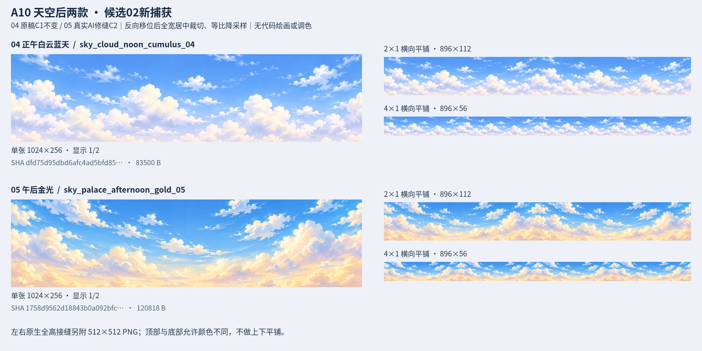
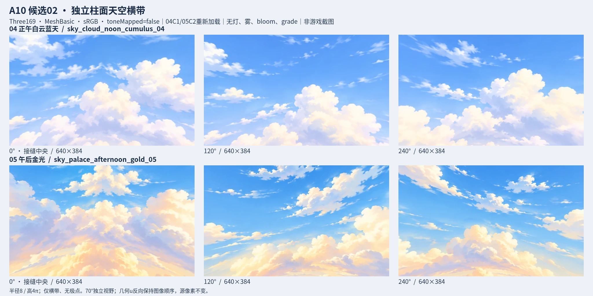

# A10-SKY-DAY 候选02：正午与午后天空横带

本批选用04原始C1和05真实AI修缝C2。两张都在新浏览器重新加载/捕获，未复用C1截图。旧C1的37证据文件保持逐字节不变。当前供Claude审核，尚未获得Claude通过，不作严格像素无缝或游戏接入声明。





## 文件与来源

| 文件 | 尺寸 | bytes |
| --- | --- | ---: |
| sky-daylight-a10.webp | 2048×1024 | 267372 |
| sky-daylight-a10-cylinder.webp | 2048×1024 | 198194 |
| sky_cloud_noon_cumulus_04-native-lr.png | 512×512 | 207981 |
| sky_cloud_noon_cumulus_04-native-full-lr-padded.png | 512×1024 | 343134 |
| sky_palace_afternoon_gold_05-native-lr.png | 512×512 | 272841 |
| sky_palace_afternoon_gold_05-native-full-lr-padded.png | 512×1024 | 411521 |
| sky_palace_afternoon_gold_05-genuine-shifted-center-native-padded.png | 512×1024 | 411521 |

两个审图WebP来自真实浏览器2048×1024 PNG，仅q92/method6格式压缩，没有后期重染/缩放/绘画。两个native-lr PNG是最终成品全512行、左右各256列原生拼接：左半取成品[1792,0,256,512]，右半取[0,0,256,512]；接缝中央无框线遮挡。两native-full PNG保留全724行，余300行只是外部padding；04为真正原稿相位，05为root反向roll+1086得到的技术恢复相位。另05 genuine-shifted-center证明真实AI输出中心x830..1341、全724行；它与恢复相位LR内容恰好相同，JSON保留两种坐标链。后者是额外来源证据，不是新增变体。所有七个可交付证据图POT/<500000B。

| ID | 选中候选 | 成品 bytes | 成品 SHA256 |
| --- | --- | ---: | --- |
| sky_cloud_noon_cumulus_04 | C1 | 83500 | dfd75d95dbd6afc4ad5bfd856b3ec3bc9065e07018b38dd82f2f17292ccb10d5 |
| sky_palace_afternoon_gold_05 | C2 | 120818 | 1758d9562d18843b0a092bfc1d24f92a4b74eedb25a715e42ed9e7d21e583705 |

root的candidate02/sky-daylight-a10.provenance.json、selection-at-export.json和afternoon-candidate02.export-record.json保存完整3次工具调用（原始2次+本次编辑1次）及参数/路径/哈希。04未再生成或重绘。05工具06:30:21→06:30:56UTC，真实原生输出2172×724RGB处于halfwrap shifted相位；不是代码绘画。

05真实shifted原稿：/workspace/world-review/sky-daylight/raw/sky_palace_afternoon_gold_05-candidate-02-shifted.png，SHA 129fee9d5daa804e4e6f08bc652df0cc8b2851f72c3ae14704c0d806c1b256b1。本helper已逐像素核root提供的unshifted-full PNG等于该原稿np.roll(+1086)。来源原稿与技术恢复相位在capture-source-before.json分别记录，没有把shifted原稿的外边缘冒充最终接缝。

root处理仅逆roll+1086、半开全宽crop[0,90,2172,633]成2172×543，Lanczos等比降为2048×512，RGB WebP q90/m6、588B冻结sRGB ICC。04保持原稿直接同crop流程。没有横向拉伸、上采样、改色、代码补缝或混合。源文件由root持有，本helper只读，capture前后两SHA/RGB保持不变。

公开draft PR117，branch codex/3d-world-sky-daylight；捕获期间root保持claimtree HEAD5a0722d3bc103c681cbecfb8a1047900ee63ca50，parent/base7ea72216176654ba77fb4f6223d4958d5ee18c67。新源码资料明确使用6fdb7eefe166877b9cb874cb3a8c27f821206519，逐份读取29现存文件，context/模块后核不变。相对7ea的真实差异：docs/CODEX_QUEUE.md, docs/WORLD3D.md, src/world/themes/harbor.ts, src/world/themes/forest.ts, src/world/themes/cloud.ts, src/app/screens/explore.ts, src/world/assets/index.ts。engine/atmos/Three/package无变化；独立脚本没有导入这些场景或WorldView，不把工作树5a称为已merge6f。

最新6f的setSky仍是渐变/太阳光盘ShaderMaterial，无纹理sampler或本批ID加载入口。4:1是**天空横带**，不是整球equirectangular或HDRI、环境灯光，不证明游戏取景/前景遮挡/调色效果。接入、旋转、极点/地平线延续与太阳处理由Claude负责。

source-first由root/docs记录实际搜索目录及访问限制；两初始调用完成06:10:19早于06:12:57规则，本次编辑发生在目录查询后。这里只记录真实时间/来源，不声明成功下载核验全部第三方候选，也未采用第三方像素文件。

## 实际命令与渲染

工作目录 `/workspace/world-review/sky-daylight/candidate02/preview-final`：

```sh
CHROME=/usr/bin/chromium node capture-tools/capture.mjs
python3 capture-tools/finalize-delivery.py
```

实际新捕获 2026-10-12T06:35:09.895Z → 2026-10-12T06:35:13.786Z，exit0，临时localhost端口45493，结束后关闭自己的服务；Chromium 154.0.8037.57、Three169、ANGLE Vulkan SwiftShader、DPR1、系统Noto CJK已loaded。两HTMLImage/两Texture加载成功，pageerror0/consolewarning0/failedrequest0；所有URL/状态/资源类型在capture-report.json。

CylinderGeometry(8,8,4π,192,1,true,0,2π)，圆周/高度4:1，无上下caps。独立几何u=1-u_default保证从内面看源图不水平倒序，v不变；接缝在+z，主板0°/120°/240°，每viewport640×384。相机[0,0,0]、upY、pitch0、verticalFOV70°、aspect640/384、near0.1/far40。05额外真实yaw180单帧查看shifted原稿外边缘恢复后的图中部，原帧单独保留。横带视野不覆盖球极点或原图全部上下边。

TextureLoader+SRGBColorSpace，wrapS=Repeat、wrapT=Clamp、repeat[1,1]、offset[0,0]、flipYtrue、anisotropy1、Linear/LinearMipmapLinear。MeshBasic白色/BackSide/opaque/toneMappedfalse/fogfalse；renderer outputSRGB、NoToneMapping/exposure1、直接render。没有灯、环境/PMREM、PBR、fog、bloom、grade、vignette或后期颜色处理，不套地面模板。

两2048×512 Orthographic Plane的真实MeshBasic+sRGB探针共2097152像素，与两成品解码RGB逐像素全等（最大通道差0）。六主板原始PNG viewport与六WebGL原帧共1474560像素全等。最终WebP板是q92有损审图，不声明它与原帧逐像素全等。原生接缝和shifted中心PNG保持解码RGB全等。RGB忠实性证明截图忠于源图，不能替代视觉接缝判断。

## 实看结论与限制

已实看新overview、三yaw整板、05 yaw0/yaw180独立原帧、两款原生LR和05全724行的恢复相位/shifted中心。C1的云尖竖直截面已由自然圆云冠替代，奶油亮云与蓝紫阴影在接缝相连；额外180°没有出现明显新的竖条。04保持原始清蓝/象牙白云，05保持蓝上空/低处柔金，未见城市、前景、文本或硬太阳盘。

独立QA实际查看C2整板/05yaw180/nativeLR后也记录旧云尖断面消除、恢复图中部无明显竖条，认为可送Claude评估；该意见不是Claude通过。云丝边缘个别像素仍不等，4×1周期主云团可辨，不能称严格像素完全无缝或无重复。顶部/底部允许不同色，不进行上下平铺。

证据：capture-source-before/after.json、capture-context-before/after.json、capture-report.json、basic-srgb-color-verification.json、review-pixel-verification.json、review-delivery.json、freeze-manifest.json。raw浏览器PNG/640×384额外原帧仅留scratch供核查；root负责挑选并复制生产文件，本helper未提交/推送/改生产或progress。
