# 猫猫图鉴（首批 24 只）

> 由 `tools/gen.ts` 自动生成。立绘 SVG 见 `assets/heroes/svg/`。

| 猫猫 | 原型 | 称号 | 阵营 | 稀有度 | 定位 | 猫种 | 生命 | 攻击 | 防御 | 速度 |
|---|---|---|---|---|---|---|---|---|---|---|
| 曹喵德 | 曹操 | 乱世奸雄 | 魏 | UR | 谋士 | 英短银渐层 | 864 | 174 | 46 | 100 |
| 夏侯墩 | 夏侯惇 | 独眼猛将 | 魏 | SSR | 先锋 | 灰虎斑 | 900 | 130 | 55 | 103 |
| 许虎痴 | 许褚 | 虎痴 | 魏 | SSR | 守护 | 沙色缅因 | 1200 | 95 | 80 | 88 |
| 郭嘉喵 | 郭嘉 | 鬼才军师 | 魏 | SR | 医者 | 白色长毛猫 | 656 | 74 | 41 | 96 |
| 刘喵备 | 刘备 | 仁德之主 | 蜀 | UR | 医者 | 橘猫 | 960 | 108 | 60 | 100 |
| 关云喵 | 关羽 | 美髯武圣 | 蜀 | SSR | 先锋 | 黑猫 | 900 | 130 | 55 | 103 |
| 张喵飞 | 张飞 | 燕人猛猫 | 蜀 | SSR | 守护 | 奶牛猫 | 1200 | 95 | 80 | 88 |
| 诸葛喵亮 | 诸葛亮 | 卧龙（卧猫） | 蜀 | SSR | 谋士 | 海豹重点色布偶 | 720 | 145 | 38 | 98 |
| 周喵瑜 | 周瑜 | 赤壁美周郎 | 吴 | UR | 谋士 | 暹罗猫 | 864 | 174 | 46 | 100 |
| 孙小霸 | 孙策 | 江东小霸王 | 吴 | SSR | 先锋 | 孟加拉豹猫 | 900 | 130 | 55 | 103 |
| 孙香香 | 孙尚香 | 弓腰姬 | 吴 | SSR | 神射 | 奶油色短毛猫 | 760 | 150 | 40 | 108 |
| 黄盖盖 | 黄盖 | 苦肉老将 | 吴 | SR | 守护 | 黄虎斑长毛 | 984 | 78 | 66 | 86 |
| 吕布丁 | 吕布 | 飞将 | 群 | UR | 先锋 | 黑白燕尾猫 | 1080 | 156 | 66 | 105 |
| 貂蝉喵 | 貂蝉 | 闭月佳猫 | 群 | SSR | 谋士 | 三花猫 | 720 | 145 | 38 | 98 |
| 董桌 | 董卓 | 暴虐桌王 | 群 | SR | 守护 | 棕色矮脚猫 | 984 | 78 | 66 | 86 |
| 华佗喵 | 华佗 | 妙手神医 | 群 | SSR | 医者 | 灰色渐层 | 800 | 90 | 50 | 98 |
| 孟喵获 | 孟获 | 南蛮盟主 | 蛮 | UR | 守护 | 亚洲豹猫 | 1440 | 114 | 96 | 90 |
| 祝融喵 | 祝融夫人 | 飞刀烈火 | 蛮 | SSR | 刺客 | 狞猫 | 700 | 150 | 38 | 122 |
| 木鹿大王 | 木鹿大王 | 驭兽萨满 | 蛮 | SSR | 谋士 | 烟灰缅因 | 720 | 145 | 38 | 98 |
| 兀突骨 | 兀突骨 | 藤甲巨兵 | 蛮 | SR | 守护 | 棕色巨型猫 | 984 | 78 | 66 | 86 |
| 左慈喵 | 左慈 | 幻术仙猫 | 仙 | UR | 谋士 | 纯白波斯 | 864 | 174 | 46 | 100 |
| 张爪 | 张角 | 太平天公 | 仙 | SSR | 谋士 | 黑白猫 | 720 | 145 | 38 | 98 |
| 水镜喵 | 司马徽 | 水镜先生 | 仙 | SSR | 医者 | 蓝灰折耳 | 800 | 90 | 50 | 98 |
| 管辂喵 | 管辂 | 神算猫 | 仙 | SR | 谋士 | 黑色短毛猫 | 590 | 119 | 31 | 96 |

---

## 魏 · 玄甲猫军

### 曹喵德（UR · 谋士）

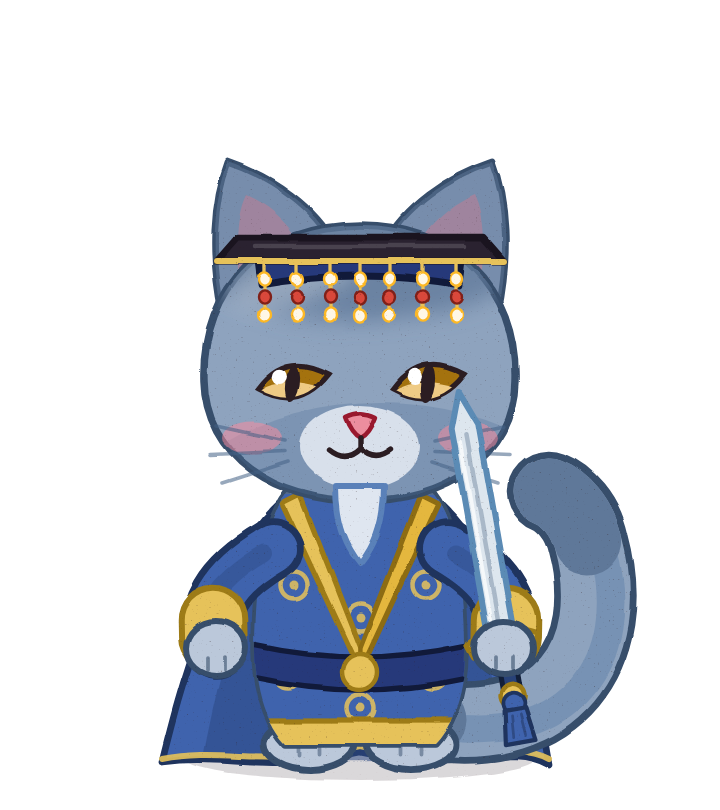

- 称号：乱世奸雄　原型：曹操
- 猫种：英短银渐层　体型：壮年 · 中等偏瘦
- 背景：玄甲猫军的统帅。宁教我负天下喵，休教天下喵负我——他把全天下的小鱼干都规划进了账本。表面严肃，实则偷偷收集各路猫猫的肉垫印。
- 台词：“本喵的爪印，就是天下的法度。”
- 喜好：收藏、账本、半夜批文书

- **普攻·令爪**（敌方随机 1 名）：造成 110% 攻击的法术伤害，并使友方元气最低的猫猫回复 8 点元气。
- **绝技·挟天子以令诸猫**（敌方全体 + 友方全体）：对敌方全体造成 180% 攻击的法术伤害；为友方全体添加「护体毛」（60% 攻击，3 回合）。场上魏势力猫猫≥3 时，护盾翻倍。
- **被动·宁我负猫**（自身）：友方猫猫阵亡时，曹喵德立刻获得 30 点元气，并使全队「炸毛」（攻击 +15%，可叠 3 层）。
- **觉醒·魏武挥鞭**（—）：绝技额外使敌方全体「受惊」（攻击 -25%，2 回合）；「宁我负猫」的元气返还提高到 50 点。

### 夏侯墩（SSR · 先锋）

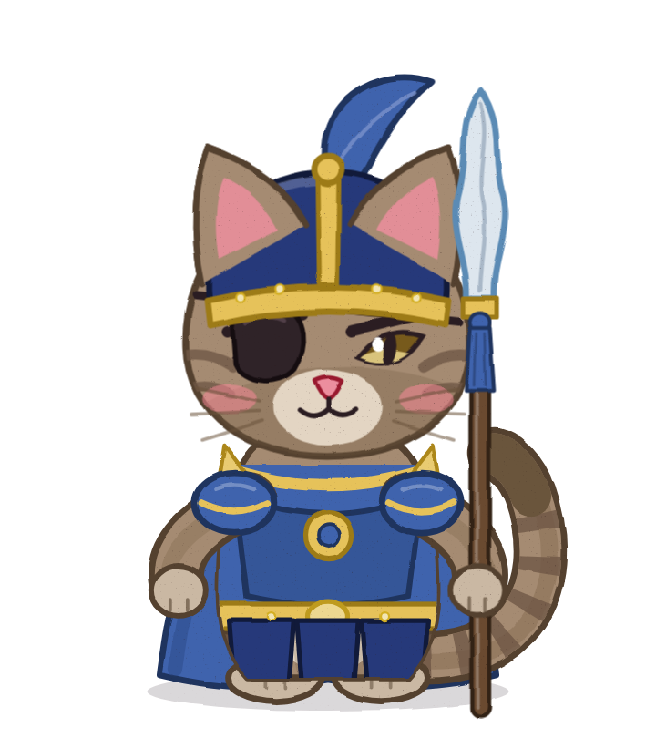

- 称号：独眼猛将　原型：夏侯惇
- 猫种：灰虎斑　体型：壮年 · 墩墩圆润
- 背景：拔矢啖睛的传说猫。据说他为了追一颗滚走的毛线球，把一只眼睛“弄丢”了——从此戴上眼罩，凶名远扬。其实眼罩下面什么都没发生。
- 台词：“一只眼，足够看穿你的小心思！”
- 喜好：毛线球、铁头功、被曹喵德摸头

- **普攻·墩爪**（敌方前排单体）：造成 130% 攻击的物理伤害。
- **绝技·拔矢啖睛**（敌方单体）：造成 320% 攻击的物理伤害，并回复本次伤害 50% 的生命；自身生命低于 50% 时，伤害 +50%。
- **被动·刚烈**（自身）：首次受到致命伤害时免死，回复 30% 生命，并「团团」1 回合（每场 1 次）。
- **觉醒·铁头不倒**（—）：受到攻击时 30% 概率反击（80% 攻击）；「刚烈」触发后攻击额外 +40%。

### 许虎痴（SSR · 守护）

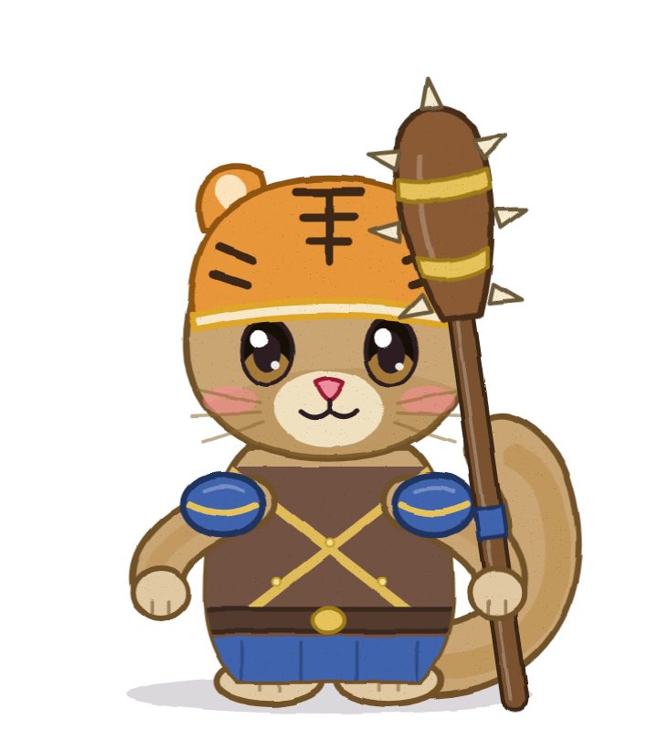

- 称号：虎痴　原型：许褚
- 猫种：沙色缅因　体型：青年 · 巨大号
- 背景：曹喵德的贴身护卫，体型是同龄猫的两倍。总觉得自己是一只老虎，因此常年戴着虎头帽。能一口气吃掉三十条小鱼干，然后把骨头整整齐齐码好。
- 台词：“嗷——本虎在此！谁敢动主公的鱼干！”
- 喜好：虎头帽、大骨头、被叫“老虎”

- **普攻·虎扑**（敌方前排单体）：造成 110% 攻击 + 50% 防御的物理伤害。
- **绝技·虎痴咆哮**（敌方全体 + 自身）：「挑衅」敌方全体 2 回合；自身获得最大生命 20% 的「护体毛」，期间伤害降低 30%。
- **被动·护主**（魏势力友方）：魏势力友方受到伤害时，30% 概率由许虎痴承担其中 50% 的伤害。
- **觉醒·真·老虎**（—）：咆哮期间每被攻击一次，反弹 30% 伤害并回复 5 点元气。

### 郭嘉喵（SR · 医者）

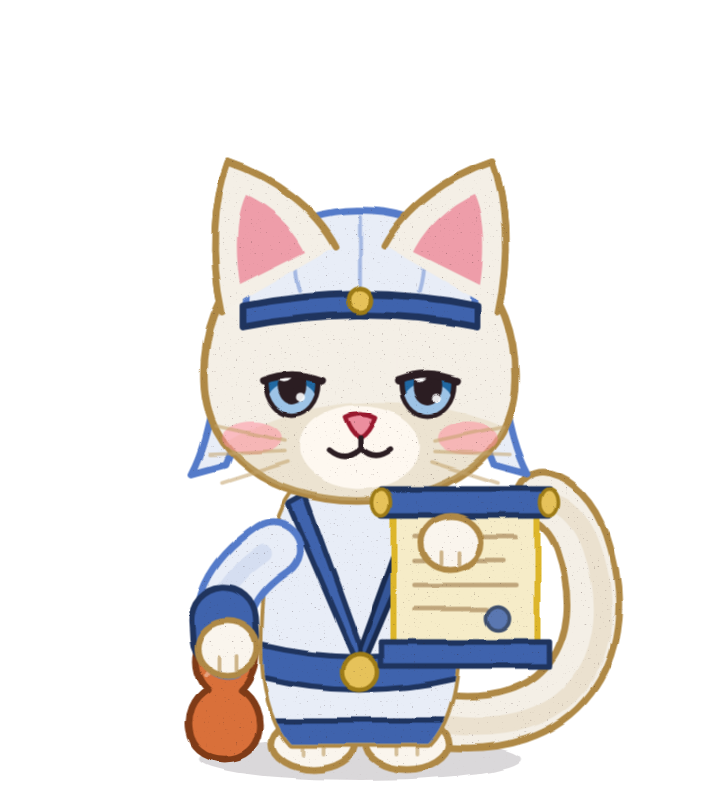

- 称号：鬼才军师　原型：郭嘉
- 猫种：白色长毛猫　体型：青年 · 慵懒瘦长
- 背景：腰间永远挂着一只酒葫芦（里面其实是猫薄荷奶）。看起来随时会睡着，却总在最关键的时候递出一个锦囊——“打开看看，别怕，里面有小鱼干。”
- 台词：“十胜十败？本喵只负责告诉你该先吃哪一条。”
- 喜好：猫薄荷奶、午睡、给人出主意

- **普攻·锦囊妙计**（友方生命最低 1 名）：回复 120% 攻击的生命。
- **绝技·遗计**（友方全体）：回复 150% 攻击的生命，并施加「遗计」：3 回合内阵亡的猫猫复活并回复 30% 生命（每猫 1 次）。
- **被动·酒葫芦**（随机友方）：每回合开始，30% 概率为随机友方净化 1 个负面效果。
- **觉醒·十胜十败**（—）：「遗计」复活的生命提高到 50%，并使其获得「炸毛」2 回合。

---

## 蜀 · 仁义猫盟

### 刘喵备（UR · 医者）

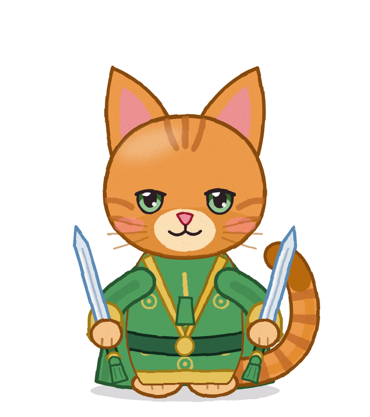

- 称号：仁德之主　原型：刘备
- 猫种：橘猫　体型：壮年 · 憨厚圆润
- 背景：一对大耳朵垂到肩膀，据说能听见全天下猫猫的肚子在叫。他没有最强的爪子，却有最暖的怀抱——所以最强的猫都愿意蹲在他脚边。
- 台词：“一碗猫粮分着吃，才是天下最香的饭。”
- 喜好：兄弟、草鞋、给大家分饭

- **普攻·仁爪**（友方生命最低 1 名 + 敌方单体）：回复 100% 攻击的生命；并对敌方单体造成 80% 攻击的伤害。
- **绝技·桃园结义**（友方全体）：回复 180% 攻击的生命，并「炸毛」（攻击 +30%，3 回合）；蜀势力友方额外获得「呼噜」（每回合 8% 最大生命，3 回合）。
- **被动·仁德**（友方）：友方生命首次低于 30% 时，自动获得一次 150% 攻击的治疗（每猫每场 1 次）。
- **觉醒·汉室永续**（—）：关云喵、张喵飞同在场时触发「结义」：三猫全属性 +20%；其中一只阵亡时，另外两只攻击再 +30%。

### 关云喵（SSR · 先锋）

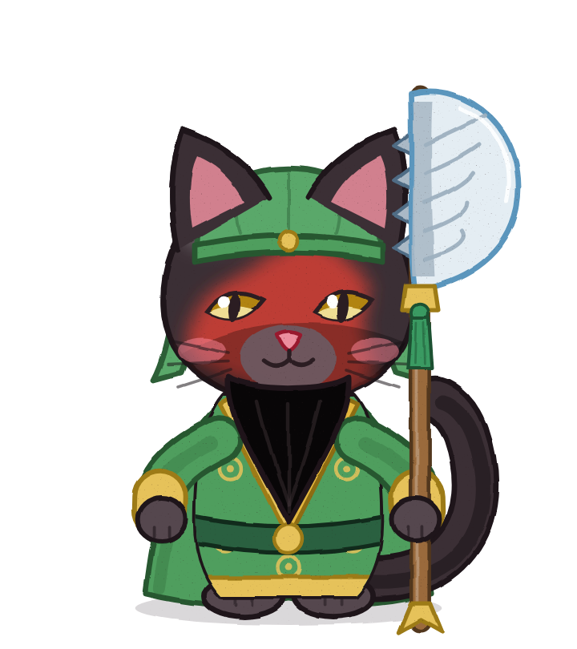

- 称号：美髯武圣　原型：关羽
- 猫种：黑猫　体型：壮年 · 高大
- 背景：胡须长到能当围巾的黑猫，脸总是红扑扑的（据说是因为喝了热奶茶）。手持青龙偃月鱼骨刀——刀刃其实是一整条鱼骨，只是他从来不肯承认。
- 台词：“温酒未凉，本喵已斩一排！”
- 喜好：春秋话本、梳胡须、鱼骨刀保养

- **普攻·偃月斩**（敌方单体）：造成 140% 攻击的物理伤害。
- **绝技·温酒斩将**（敌方纵列）：对敌方一整列造成 260% 攻击的物理伤害；若击杀目标，立刻再行动一次并回复 20 点元气（每回合 1 次）。
- **被动·义绝**（自身）：每次暴击，攻击 +10%，最多叠加 5 层；叠满时暴击伤害 +30%。
- **觉醒·过五关**（—）：击杀敌人后，下一次普攻变为对敌方全体造成 80% 攻击的伤害。

### 张喵飞（SSR · 守护）

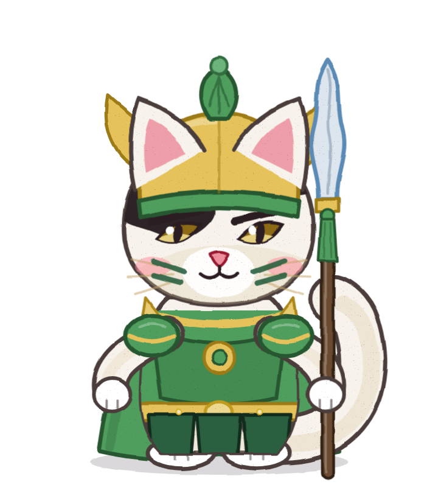

- 称号：燕人猛猫　原型：张飞
- 猫种：奶牛猫　体型：壮年 · 浑圆结实
- 背景：嗓门比体型还大的奶牛猫，一声吼叫能让整座桥的鱼干都抖三抖。表面豪爽，其实最怕打雷，每次打雷都会躲到刘喵备怀里装“保护大哥”。
- 台词：“燕人张喵飞在此！谁敢与我决一死战！”
- 喜好：大碗喝奶、蛇矛、被大哥夸

- **普攻·蛇矛点**（敌方前排单体）：造成 100% 攻击的物理伤害，30% 概率使目标「晕乎乎」1 回合。
- **绝技·当阳一吼**（敌方全体）：造成 140% 攻击的物理伤害，使敌方全体「受惊」（攻击 -20%，2 回合），并随机使 1 名敌人「晕乎乎」1 回合。
- **被动·燕人风骨**（自身）：生命每降低 20%，防御 +10%。
- **觉醒·喝断长坂桥**（—）：咆哮后获得「挑衅」1 回合与 30% 减伤；对「受惊」目标的伤害 +30%。

### 诸葛喵亮（SSR · 谋士）

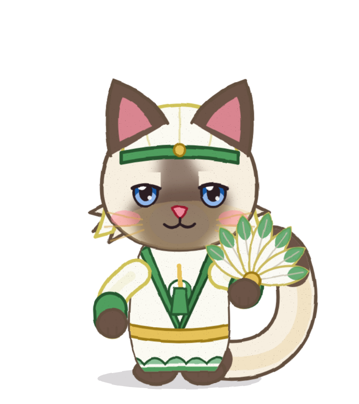

- 称号：卧龙（卧猫）　原型：诸葛亮
- 猫种：海豹重点色布偶　体型：青年 · 轻盈
- 背景：常年蜷在屋里“卧”着，被刘喵备三顾茅庐才肯出山。羽毛扇其实是逗猫棒——想事情的时候会不自觉地盯着它看，所以他总说“让我再想想”。
- 台词：“借你一阵东风，也借你三条小鱼干。”
- 喜好：羽毛扇、观星、晒太阳

- **普攻·羽扇一挥**（敌方单体）：造成 120% 攻击的法术伤害，20% 概率使目标「毛线缠」1 回合。
- **绝技·八阵图**（敌方全体 + 友方全体）：对敌方全体造成 150% 攻击的法术伤害，并使其速度 -20%（2 回合）；友方全体获得「护体毛」（50% 攻击，2 回合）。
- **被动·卧龙**（友方全体）：战斗开始时友方全体元气 +30；每有一名友方阵亡，诸葛喵亮回复 20 点元气。
- **觉醒·借东风**（—）：八阵图额外使友方吴势力猫猫「炸毛」40%；若周喵瑜在场，其「灼烧」伤害翻倍（羁绊·火烧赤壁）。

---

## 吴 · 赤焰水师

### 周喵瑜（UR · 谋士）

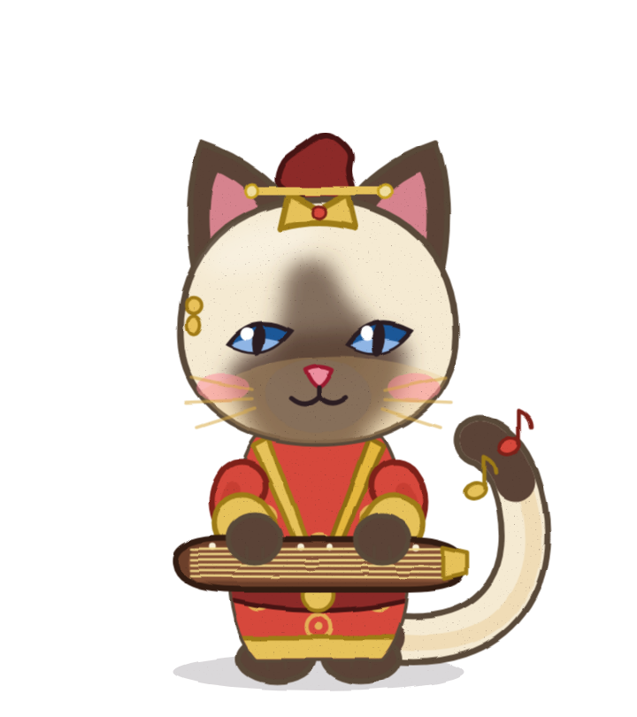

- 称号：赤壁美周郎　原型：周瑜
- 猫种：暹罗猫　体型：青年 · 修长优雅
- 背景：精通音律的暹罗猫，一曲琴音能让整个水寨的猫猫打拍子。对手弹错一个音，他就会回头看一眼——然后那个对手就“莫名其妙”着火了。
- 台词：“曲有误，周郎顾。火，也一样。”
- 喜好：古琴、赤红色、被夸好看

- **普攻·琴音**（敌方随机 2 名）：各造成 90% 攻击的火焰伤害，并施加「灼烧」（每回合 25% 攻击，2 回合）。
- **绝技·赤壁火海**（敌方全体）：造成 200% 攻击的火焰伤害并「灼烧」3 回合；对「淋湿」目标额外 +60% 伤害。
- **被动·曲有误**（敌方）：敌方每次释放绝技，周喵瑜立刻对其造成 80% 攻击的伤害，并叠加 1 层灼烧。
- **觉醒·连环计·燎原**（—）：灼烧每回合自动叠加 1 层（最多 5 层）；灼烧目标死亡时，把所有层数传给随机敌人。

### 孙小霸（SSR · 先锋）

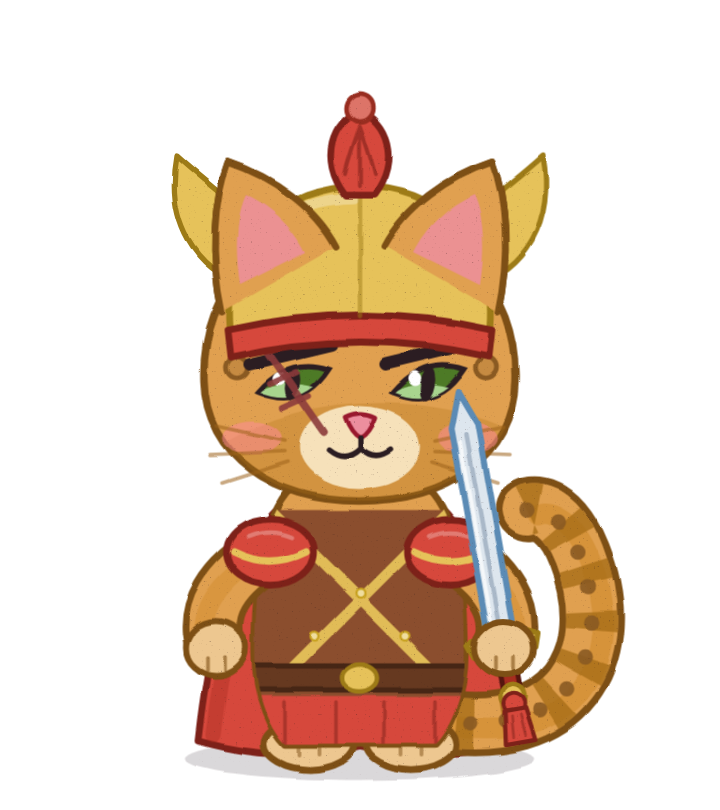

- 称号：江东小霸王　原型：孙策
- 猫种：孟加拉豹猫　体型：青年 · 精悍
- 背景：精力旺盛到停不下来的豹猫，一天能打翻十七只水碗。凭着一把长剑和一腔热血，几个月就把江东收入了爪下。唯一的缺点是不爱洗澡。
- 台词：“前方是水还是火？本喵先跳了再说！”
- 喜好：冲浪、打架、跑酷

- **普攻·长剑突**（敌方单体）：造成 130% 攻击的物理伤害。
- **绝技·霸王横扫**（敌方前排）：对敌方前排造成 230% 攻击的物理伤害，并使其「淋湿」（防御 -20%，2 回合）。
- **被动·江东猛虎**（自身）：每回合首次攻击必定暴击，暴击时回复 5 点元气。
- **觉醒·小霸王归位**（—）：阵亡时对敌方全体造成 200% 攻击的伤害，并使吴势力友方攻击 +25%。

### 孙香香（SSR · 神射）

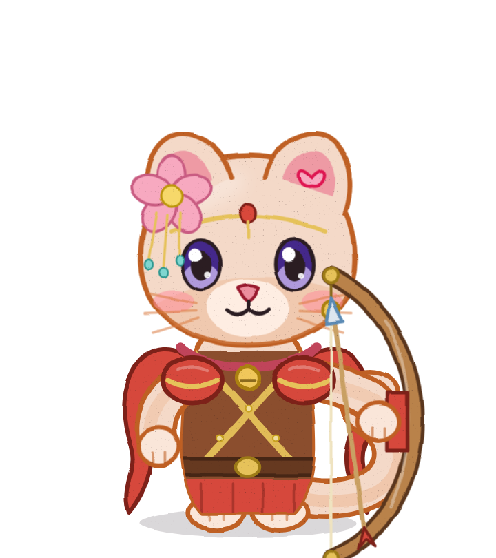

- 称号：弓腰姬　原型：孙尚香
- 猫种：奶油色短毛猫　体型：少年 · 灵巧
- 背景：孙家最小的小公主，从小玩弓箭长大，箭尖上总系着一只小铃铛——这样箭射出去，大家就知道是“香香大人”来了。
- 台词：“嘘——听到铃铛响，就该低头了哦。”
- 喜好：小铃铛、花、拉弓

- **普攻·铃铛箭**（敌方后排随机 1 名）：造成 140% 攻击的物理伤害。
- **绝技·连珠铃箭**（敌方随机）：连射 5 箭，每箭对随机敌人造成 80% 攻击的伤害；对「灼烧」或「淋湿」目标暴击率 +30%。
- **被动·回马弓**（攻击者）：受到近战攻击时，20% 概率反射一箭（100% 攻击，每回合 1 次）。
- **觉醒·弓腰**（—）：暴击后追射一支箭（60% 攻击）；被铃铛箭命中的敌人获得「铃铛标记」（受伤 +10%，2 回合）。

### 黄盖盖（SR · 守护）

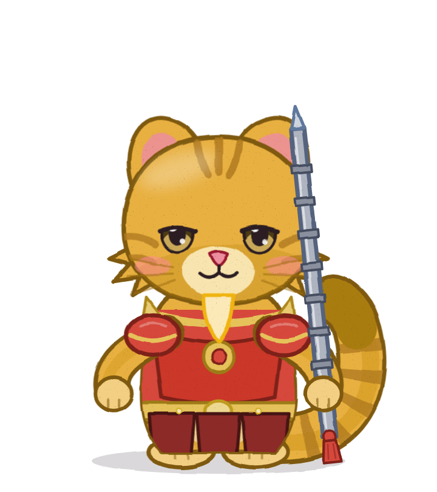

- 称号：苦肉老将　原型：黄盖
- 猫种：黄虎斑长毛　体型：老年 · 圆滚滚
- 背景：资历最老的橘黄老猫，白胡子垂到胸口。为了赤壁大计甘愿“挨打”，趴在地上哼哼：“盖盖不疼，盖盖不疼……”——事后偷偷多吃了三块鱼干。
- 台词：“老骨头硬着呢，来，朝这儿打！”
- 喜好：热毯子、晒肚皮、年轻猫的崇拜

- **普攻·铁鞭**（敌方前排单体）：造成 110% 攻击的物理伤害。
- **绝技·苦肉计**（自身 + 友方全体）：自损 15% 最大生命，换取友方全体「护体毛」（自身最大生命 15%，3 回合），吴势力友方攻击 +20%（3 回合）。
- **被动·老当益壮**（自身）：生命每降低 10%，减伤 +3%，最多 +30%。
- **觉醒·诈降**（敌方全体）：苦肉计后的下一回合，对敌方全体造成 150% 攻击的火焰伤害（降书藏火）。

---

## 群 · 乱世群英

### 吕布丁（UR · 先锋）

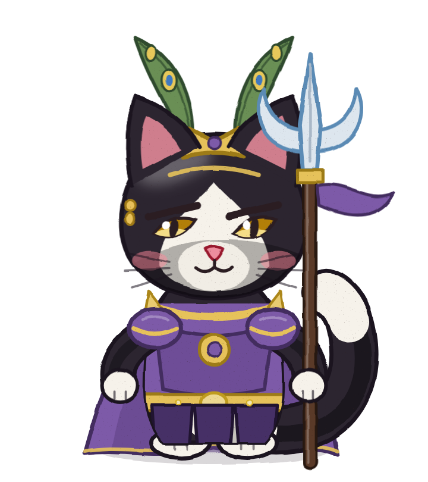

- 称号：飞将　原型：吕布
- 猫种：黑白燕尾猫　体型：壮年 · 威武
- 背景：天下第一的燕尾服猫，雉尾冠在风中一晃就是一场败仗。传说他有一匹叫“赤兔”的坐骑——其实是一只很胖的兔子。外号“布丁”，因为被摸肚子时会软得像布丁。
- 台词：“人中吕布，猫中布丁！谁与我争锋？”
- 喜好：方天画戟、赤兔（兔）、软萌的东西

- **普攻·画戟**（敌方单体）：造成 140% 攻击的物理伤害，暴击时 20% 概率追加一次攻击。
- **绝技·天下无双**（敌方后排全体）：造成 250% 攻击的物理伤害，本次暴击率 +50%；击杀目标时返还 50 点元气。
- **被动·飞将**（自身）：战斗开始时攻击 +20%；速度高于目标时伤害 +20%。
- **觉醒·赤兔（兔）**（—）：每回合首次行动后，50% 概率立刻额外行动一次（骑着一只很胖的兔子）。

### 貂蝉喵（SSR · 谋士）

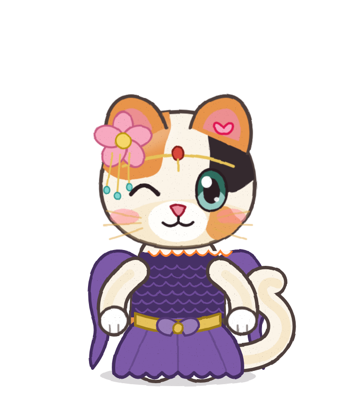

- 称号：闭月佳猫　原型：貂蝉
- 猫种：三花猫　体型：青年 · 轻盈
- 背景：舞姿让月亮都躲进云里的三花猫。她的武器不是爪子，而是一个眼神——被看到的猫会忍不住去追一根并不存在的逗猫棒。
- 台词：“你的眼里有星星呢——要不要，借我一颗？”
- 喜好：跳舞、月光、被追着跑

- **普攻·回眸**（敌方单体）：造成 110% 攻击的法术伤害，30% 概率使其「猫薄荷醉」1 回合。
- **绝技·连环美人计**（敌方 2 名）：使目标「猫薄荷醉」2 回合，醉倒者会攻击队友（其攻击 100%），且受到的伤害 +20%。
- **被动·闭月**（攻击者）：受到攻击时，25% 概率使攻击者「猫薄荷醉」1 回合。
- **觉醒·月下独舞**（—）：醉倒的敌人死亡时，使另一名敌人「猫薄荷醉」；若吕布丁在场，每有敌人醉倒，其攻击 +15%。

### 董桌（SR · 守护）

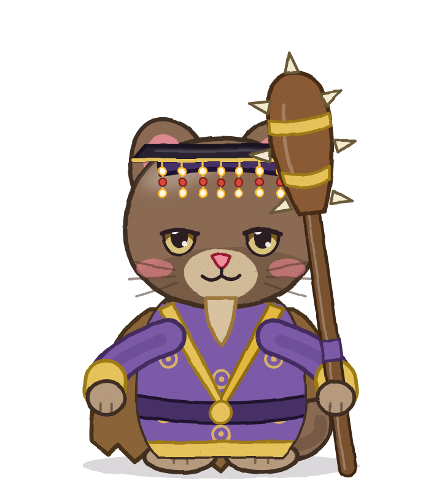

- 称号：暴虐桌王　原型：董卓
- 猫种：棕色矮脚猫　体型：老年 · 极圆
- 背景：胖到可以当桌子用的暴君，坐在哪里，哪里就是饭桌。他的口头禅是“都给本桌让开”。肚子里藏着无数小鱼干，一旦被戳破——全场都会掉鱼。
- 台词：“本桌说了算！饭，端上来！”
- 喜好：吃、更多的吃、让别的猫端盘子

- **普攻·拍桌**（敌方前排单体）：造成 100% 攻击的物理伤害，并获得最大生命 5% 的「护体毛」。
- **绝技·掀桌**（敌方全体 + 自身）：「挑衅」敌方全体 1 回合，造成 100% 攻击的伤害，自身获得最大生命 25% 的「护体毛」。
- **被动·暴虐**（自身）：生命每降低 10%，攻击 +5%，最多 +50%。
- **觉醒·桌下藏鱼**（友方全体）：阵亡时桌下滚出小鱼干，友方全体回复 25% 最大生命。

### 华佗喵（SSR · 医者）

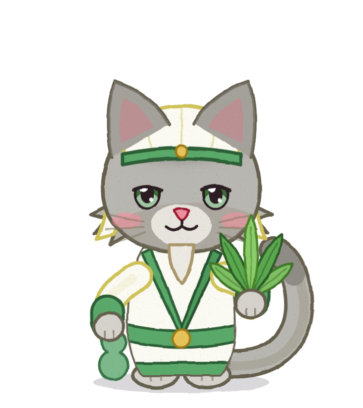

- 称号：妙手神医　原型：华佗
- 猫种：灰色渐层　体型：老年 · 慈祥
- 背景：走遍乱世的游医猫，白胡子里夹着药草屑。他的“麻沸散”其实是特调猫薄荷汤，喝了让人舒服得直打呼噜，伤口不知不觉就好了。
- 台词：“来，肉垫伸出来——不疼，就像被舔了一口。”
- 喜好：草药、呼噜声、病猫康复

- **普攻·针灸**（友方生命最低 1 名）：回复 130% 攻击的生命。
- **绝技·麻沸散**（友方全体）：回复 150% 攻击的生命并净化所有负面效果；对「晕乎乎」「猫薄荷醉」中的友方额外回复 50%。
- **被动·五禽戏**（友方生命最低 2 名）：每回合开始为目标施加「呼噜」（每回合 6% 最大生命，2 回合）。
- **觉醒·刮骨疗毒**（友方）：友方生命低于 40% 时，受到的治疗 +50%；每场 1 次，复活一名阵亡友方并回复 40% 生命。

---

## 蛮 · 南蛮猫寨

### 孟喵获（UR · 守护）

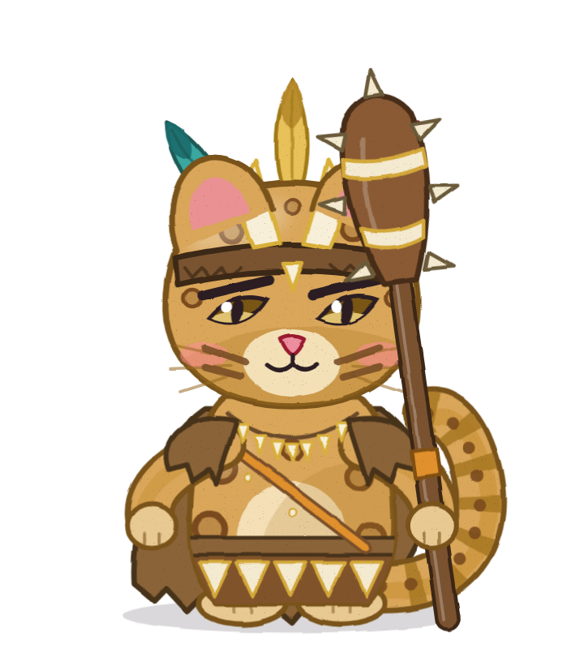

- 称号：南蛮盟主　原型：孟获
- 猫种：亚洲豹猫　体型：壮年 · 魁梧
- 背景：南蛮猫寨的盟主，被擒七次、放七次，每次都带着更多的鱼回来：“再来！这次我吃饱了！”——输得越多，越抗揍，越难缠。
- 台词：“七次不算！本盟主还能再战七次！”
- 喜好：被抓住后的酒宴、骨头棒、不服输

- **普攻·骨棒**（敌方前排单体）：造成 120% 攻击的物理伤害，并为自身叠加 1 层「图腾」。
- **绝技·七擒七纵**（敌方单体）：造成 250% 攻击的物理伤害并使其「晕乎乎」1 回合；自身获得「九命」（3 回合内至少保留 1 点生命）。
- **被动·不服**（自身）：生命每降低 10%，伤害 +4%、防御 +4%，最多 +40%。
- **觉醒·第七次**（自身）：每场战斗中，第 7 次受到攻击时立刻满元气并回复 30% 生命。

### 祝融喵（SSR · 刺客）

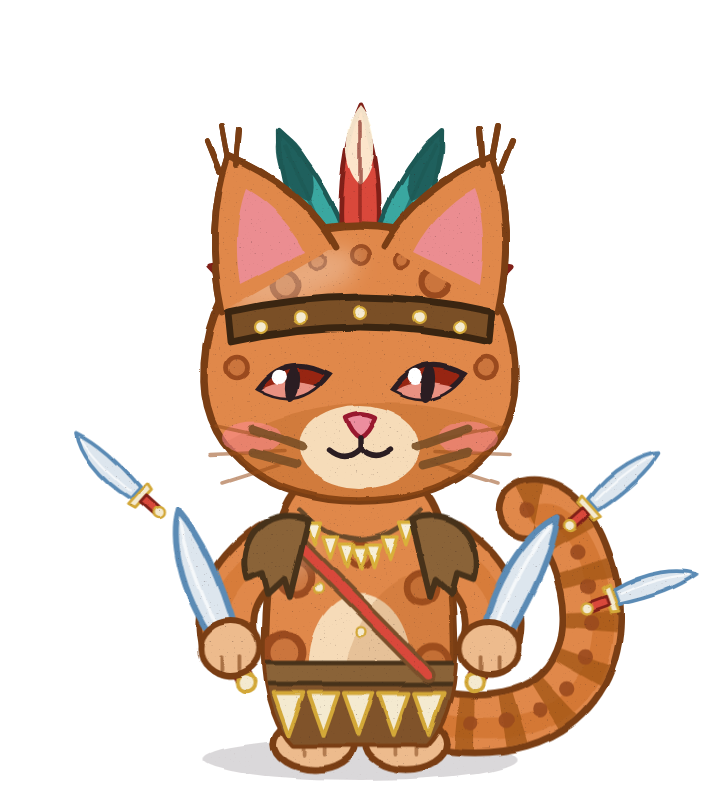

- 称号：飞刀烈火　原型：祝融夫人
- 猫种：狞猫　体型：青年 · 敏捷
- 背景：耳尖带着长长毛簇的狞猫，一把飞刀能绕树三圈再回到手里。脾气像她的名字一样火爆，被惹毛时尾巴会真的冒火星子。
- 台词：“看刀！——哎？刀呢？哦，在你背后。”
- 喜好：飞刀、烤鱼、火堆边跳舞

- **普攻·飞刀**（敌方后排随机 1 名）：造成 140% 攻击的物理伤害，30% 概率施加「抓痕」（每回合 30% 攻击，2 回合）。
- **绝技·烈火回旋**（敌方后排）：掷出 3 把飞刀，每把造成 100% 攻击的伤害并「灼烧」；目标有「抓痕」时，飞刀返回再造成 60% 伤害。
- **被动·火神后裔**（自身）：暴击时回复 10 点元气；对生命低于 50% 的敌人伤害 +30%。
- **觉醒·刀回三匝**（—）：飞刀增至 5 把；飞刀暴击时，为自身叠加 1 层「图腾」。

### 木鹿大王（SSR · 谋士）

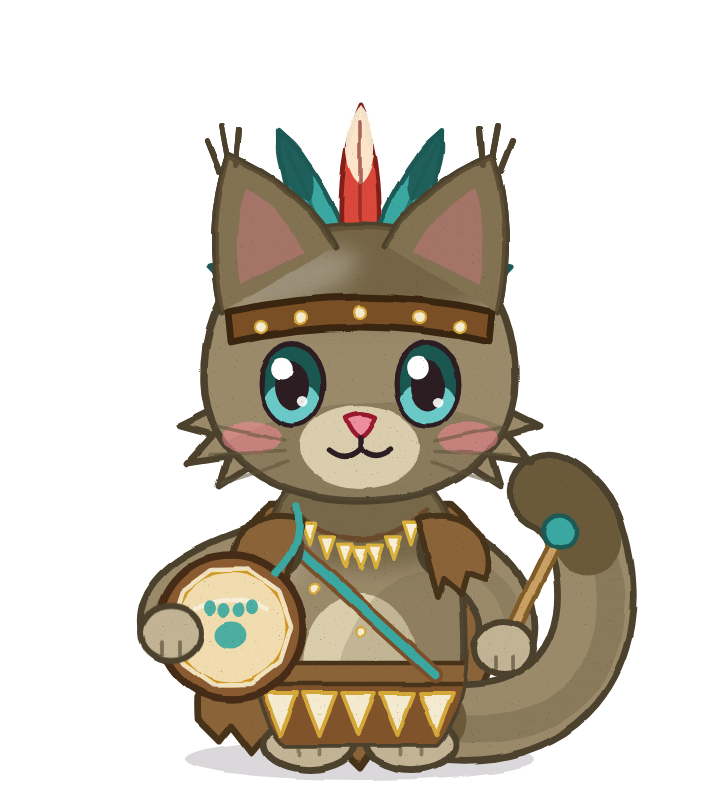

- 称号：驭兽萨满　原型：木鹿大王
- 猫种：烟灰缅因　体型：壮年 · 神秘
- 背景：会和山林里所有生物聊天的萨满猫，一敲兽鼓，虎豹豺狼就会从林子里钻出来排队。不过他自己其实有点怕狗。
- 台词：“嗡——山林听我号令。啊，那只狗别过来！”
- 喜好：兽鼓、羽毛、森林的味道

- **普攻·鼓点**（敌方单体）：造成 110% 攻击的法术伤害，并叠加 1 层「图腾」。
- **绝技·百兽朝鼓**（敌方随机）：消耗全部图腾，召唤等量山林猛兽（虎 / 豹 / 狼）扑向随机敌人，每只造成 90% 攻击的伤害并施加「抓痕」；图腾不足时至少召唤 2 只。
- **被动·兽语**（蛮势力友方）：蛮势力友方每次普攻，30% 概率为木鹿大王叠加 1 层图腾。
- **觉醒·万兽齐鸣**（—）：召唤的猛兽留场 2 回合并持续攻击；图腾层数上限 +3。

### 兀突骨（SR · 守护）

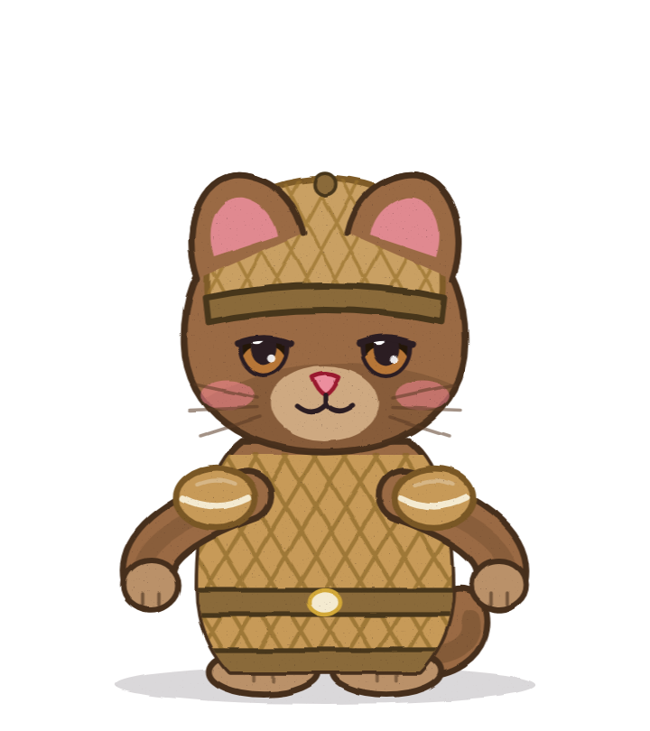

- 称号：藤甲巨兵　原型：兀突骨
- 猫种：棕色巨型猫　体型：壮年 · 巨大
- 背景：穿着藤编甲的巨猫，据说那身甲是用最舒服的猫窝编成的——刀枪不入，只怕火。每次一开打他就想钻进自己的甲里睡觉。
- 台词：“嗯……嗯……（缩进藤甲里）……请继续。”
- 喜好：藤编猫窝、睡觉、纸箱

- **普攻·藤拳**（敌方前排单体）：造成 100% 攻击的物理伤害。
- **绝技·缩甲**（自身）：获得最大生命 30% 的「护体毛」，期间物理伤害降低 50%，并反弹 30% 的近战伤害。
- **被动·藤甲**（自身）：受到的物理伤害降低 20%，但受到的火焰伤害提高 50%（天生怕火）。
- **觉醒·钻进猫窝**（自身）：缩甲结束时，把剩余护盾的 100% 转化为生命；火焰易伤降为 20%。

---

## 仙 · 天机玄门

### 左慈喵（UR · 谋士）

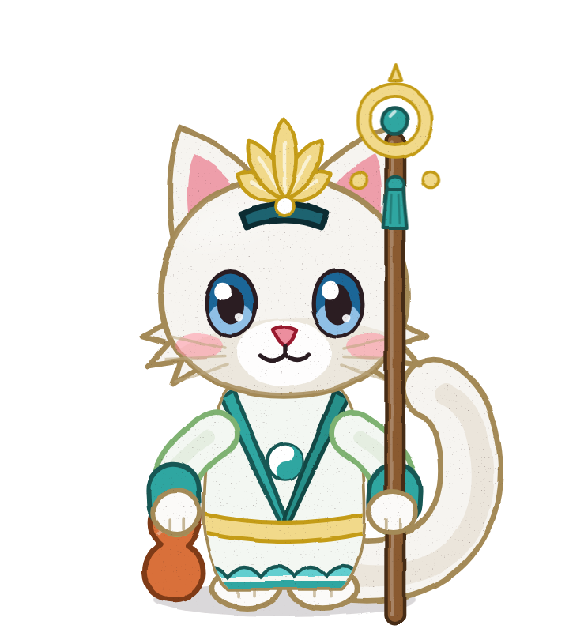

- 称号：幻术仙猫　原型：左慈
- 猫种：纯白波斯　体型：不详 · 飘逸
- 背景：没有人见过他出生，也没有人见过他睡觉。传说他一伸懒腰，天空就会下起小鱼雨。他总说“这一切都是幻象”，但你伸手去摸，他的肚子真的很软。
- 台词：“你看见的是我，还是你想看见的我？”
- 喜好：云、幻术、被追问“你是不是真的”

- **普攻·幻爪**（敌方单体）：造成 120% 攻击的法术伤害，30% 概率使其「毛线缠」1 回合。
- **绝技·千幻万象**（敌方全体 + 友方全体）：对敌方全体造成 160% 攻击的法术伤害；友方全体获得「幻象」（闪避下一次攻击）。
- **被动·天命**（自身）：每回合开始 30% 概率触发天命，随机获得其一：额外行动 / 回复 50 点元气 / 无敌 1 回合。
- **觉醒·庄周梦猫**（—）：天命触发率提高到 50%，且每次同时触发两种效果。

### 张爪（SSR · 谋士）

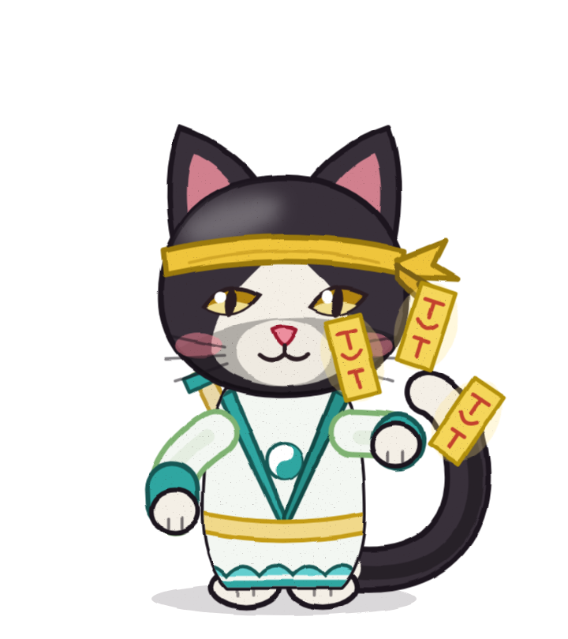

- 称号：太平天公　原型：张角
- 猫种：黑白猫　体型：壮年 · 瘦削
- 背景：“苍天已死，黄天当立”的喊话猫，头上的黄巾是他最爱的围脖。符水其实是加了小鱼干汤的开水，喝了心里暖烘烘——这就是太平道最大的秘密。
- 台词：“诸位，伸出爪子！今天咱们……一起舔舔毛！”
- 喜好：黄符、符水、集体活动

- **普攻·符水**（敌方单体）：造成 110% 攻击的法术伤害，并施加 1 层「符咒」（受到伤害 +10%，最多 3 层）。
- **绝技·黄天当立**（敌方全体）：造成 140% 攻击的法术伤害并使其「毛线缠」1 回合；每层「符咒」额外造成 50% 攻击的伤害。
- **被动·太平要术**（自身）：友方每有一只猫猫阵亡，攻击 +15%（可叠加）。
- **觉醒·苍天已死**（—）：符咒层数上限 +2；带符咒的敌人死亡时，符咒扩散给随机敌人。

### 水镜喵（SSR · 医者）

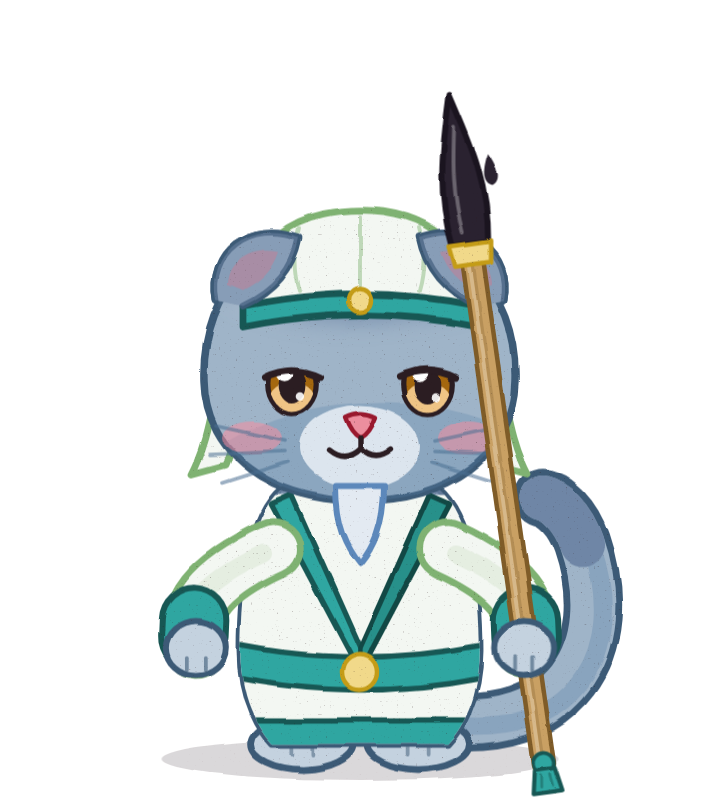

- 称号：水镜先生　原型：司马徽
- 猫种：蓝灰折耳　体型：老年 · 温和
- 背景：喜欢坐在池塘边看水面的老先生，口头禅是“好，好，好。”据说他能从水镜里看见每只猫的前程，只是总忘了说出来。
- 台词：“好，好，好……你这孩子，很有前途。”
- 喜好：池塘、茶、学生们的小报告

- **普攻·镜花**（友方生命最低 1 名）：回复 120% 攻击的生命，并附带「护体毛」（40% 攻击，2 回合）。
- **绝技·水镜观势**（友方全体）：回复 120% 攻击的生命，使其下一次受到的伤害降低 40%，并回复 20 点元气。
- **被动·好，好，好**（友方）：每回合开始，为元气最低的友方回复 10 点元气；友方受到治疗时，20% 概率获得「炸毛」。
- **觉醒·伏龙凤雏**（—）：若诸葛喵亮在场，双方互相共享 30% 的增益效果；蜀 / 仙势力友方受到治疗 +10%。

### 管辂喵（SR · 谋士）

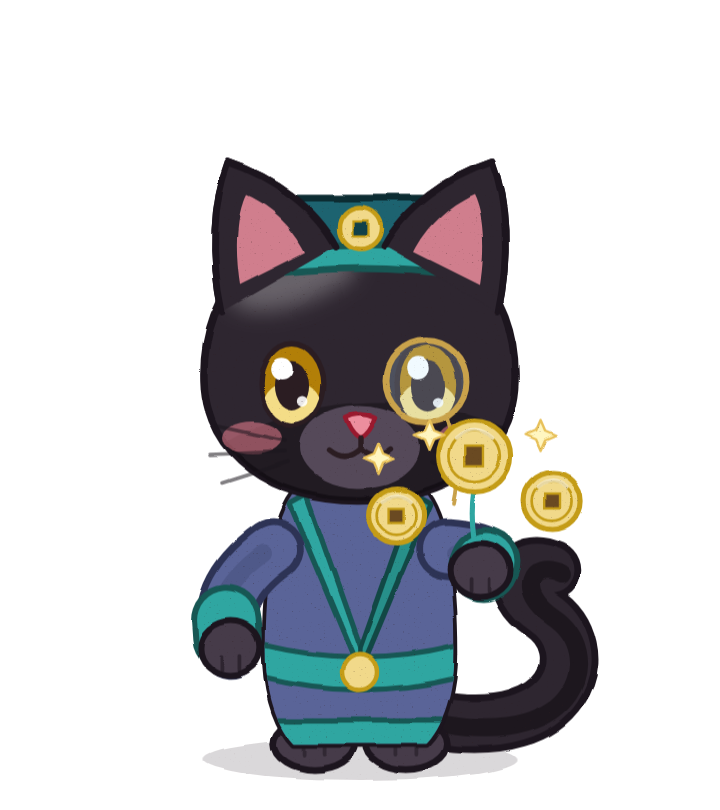

- 称号：神算猫　原型：管辂
- 猫种：黑色短毛猫　体型：青年 · 神秘
- 背景：占卜摊摆在街角的黑猫，铜钱一抛就知道对面是赢是输——但他从不告诉你，只是微微一笑：“天机不可泄露，除非你给小鱼干。”
- 台词：“三枚铜钱，一个小鱼干，算你的命，值。”
- 喜好：铜钱、街角摊位、卖关子

- **普攻·抛铜钱**（敌方单体）：造成 100% 攻击的法术伤害；50% 概率「正面」：再追加 50% 攻击的伤害，「反面」：回复自身 10 点元气。
- **绝技·卜卦**（敌方全体 / 友方全体）：抛 3 枚铜钱：每枚正面，对敌方全体造成 80% 攻击的伤害；每枚反面，为友方全体添加「护体毛」（40% 攻击）。
- **被动·天机**（敌方）：战斗开始时窥探敌方元气最高的猫猫，使其元气 -30。
- **觉醒·铜钱剑**（—）：铜钱增至 5 枚；全部正面时，额外对敌方全体造成 200% 攻击的伤害。

---

## 羁绊

- **桃园结义**（刘喵备、关云喵、张喵飞）：三猫全属性 +20%；任一阵亡，其余两只攻击 +30%。
- **火烧赤壁**（诸葛喵亮、周喵瑜）：灼烧伤害 +30%；诸葛喵亮的八阵图额外「炸毛」吴势力友方。
- **魏武之道**（曹喵德、夏侯墩、许虎痴）：魏势力「护体毛」效果 +30%，曹喵德元气获取 +20%。
- **美人连环**（貂蝉喵、吕布丁、董桌）：敌人「猫薄荷醉」时长 +1 回合；吕布丁攻击 +25%。
- **七擒七纵**（孟喵获、祝融喵、木鹿大王、兀突骨）：「图腾」层数上限 +3；蛮势力友方生命 +15%。
- **天机四象**（左慈喵、张爪、水镜喵、管辂喵）：「天命」触发率 +15%；仙势力技能「毛线缠」命中 +20%。
- **杏林同盟**（华佗喵、郭嘉喵、水镜喵）：全队治疗效果 +20%，净化时附带「呼噜」1 回合。
- **江东之虎**（孙小霸、孙香香、黄盖盖）：吴势力友方暴击率 +15%；灼烧目标受到的所有伤害 +10%。
