# 第二批猫猫设定与外观

本批按 [Issue #29](https://github.com/acaozixu123456/myRepository/issues/29) 固定表交付十四只；名单与外观取舍已经 [Claude 统一答复](https://github.com/acaozixu123456/myRepository/issues/29#issuecomment-6106422652) 确认。首批二十四只加本批十四只，常规名册 `STANDARD_HEROES` 合计三十八只；主线另有三只至尊 SP，全量 `HEROES` 为四十一只，SP 不计入本批或常规平衡样本。蜀族本批四只，其中黄忠忠、马超超、姜喵维为 SR，六族现在均有 SR。

以下设定与 `src/data/heroes.ts` 一致。截图直接读取已注册英雄，头像沿游戏现有头像视窗，全身沿设定集完整视窗，均由原 `catSvg` 输出。SSR 使用银质镶边；SR 保留朴素装束，没有光眼或金光，马超的素色披风按 Issue 明确许可采用。

## 张喵辽 · 逍遥津突阵将

`wei_zhangliao`｜魏 · 先锋 · SSR｜原型：张辽

品种：灰蓝短毛猫；年龄与体型：壮年 · 精瘦矫健；喜欢：窄桥上的风、利落的双刃、安静点兵。

> 跟紧这一步。桥口虽窄，回家的路总要留着。

背景（92 字）：逍遥津的桥口只够几条尾巴并肩，他偏能从中寻出路来。点兵时话不多，总把最窄的一段留给自己；同伴少了，脚步反而更利落。凯旋后众猫夸他胆大，他却认真纠正：桥不宽，喊得太响会把睡着的船夫吵醒。

**外观**：灰蓝纯色短毛、尖耳短尾，精瘦身形与银边玄甲；将军盔配双短刀 `dualBlades`，与夏侯墩的虎纹圆身、独眼和长枪区分。

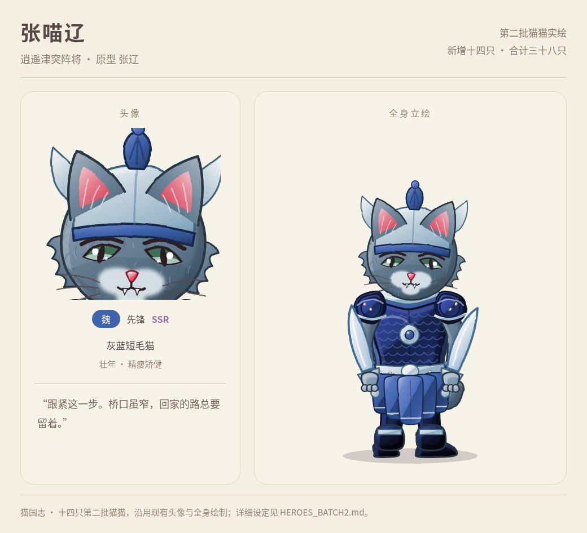

## 徐晃晃 · 亚夫风范

`wei_xuhuang`｜魏 · 守护 · SR｜原型：徐晃

品种：银虎斑美国短毛猫；年龄与体型：壮年 · 宽肩敦实；喜欢：整齐的营图、斧柄保养、替新兵留路。

> 名字可以晃，前排这一步不能晃。

背景（98 字）：银虎斑的条纹像营里的界线，走到哪里都整整齐齐。徐晃晃练兵先教站稳，再教收好尾巴，连打盹也得给过路猫留空。他的大斧常用来压住被风掀起的营图；新兵以为将军从不晃，后来才发现，他只是替大家把晃动接住了。

**外观**：银虎斑美短、圆耳卷尾与宽肩身形；玄甲盔、灰银边重甲与长柄大斧 `axe`，无披风或光眼。

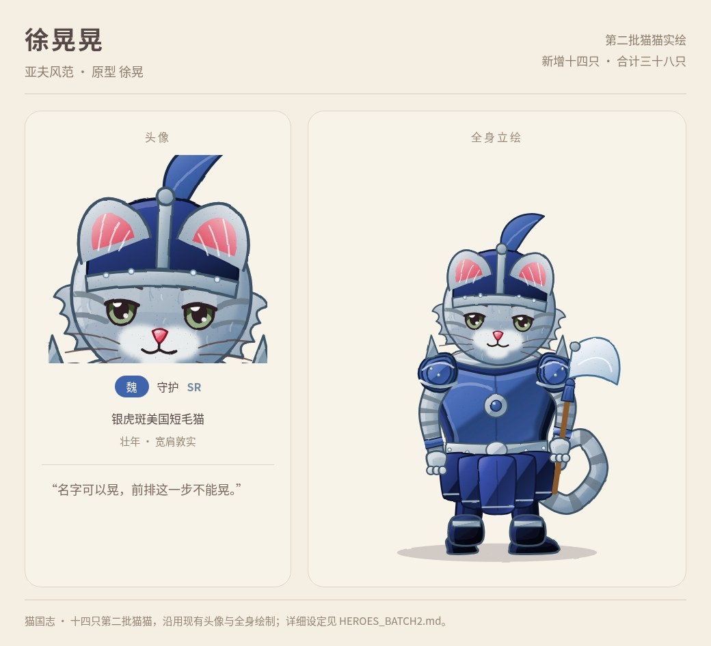

## 黄忠忠 · 定军老弓

`shu_huangzhong`｜蜀 · 神射 · SR｜原型：黄忠

品种：白橘长毛猫；年龄与体型：老年 · 硬朗精干；喜欢：平整的箭靶、长弓的弦声、后辈认真练箭。

> 靶子再挪远些。老眼还没答应你们先歇。

背景（92 字）：军中给黄忠忠搬来矮凳，他却用它垫高了箭靶。老猫眯着眼，不是没瞧清，是嫌年轻猫站得太近。弓弦拨出清脆的一声，连射总到最后一箭才肯歇；练完还替后辈把靶纸展平，免得明日又说，是纸皱了才射偏。

**外观**：白色口鼻与肚皮、细橘虎纹、蓬松面颊与眯眼；朴素绿轻甲、长弓 `bow` 与短白须 `beardGoat`，无披风。

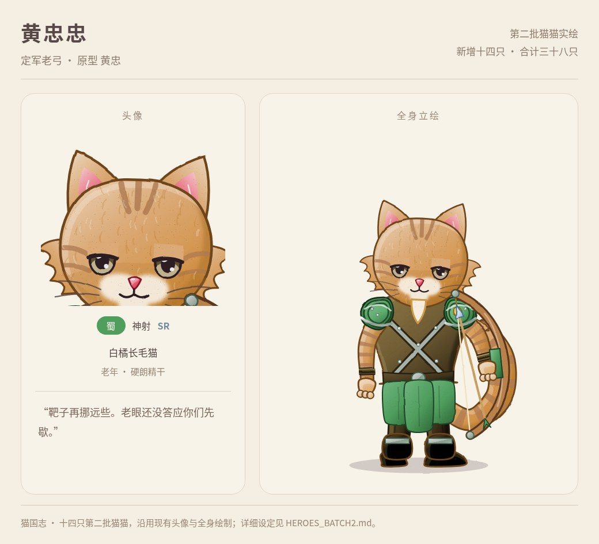

## 马超超 · 西凉锦将

`shu_machao`｜蜀 · 先锋 · SR｜原型：马超

品种：白底黑花短毛猫；年龄与体型：青年 · 挺拔轻快；喜欢：西凉长风、奔跑后理齐衣领、结伴探路。

> 我先探路，待会儿回来接你。别追着我的衣带跑。

背景（96 字）：西凉的风一起来，马超超就忍不住先跑几步。锦衣还没拂平，枪尖已替队伍探好下一处转角；听见同伴喊停，他又绕回来接最慢的那只猫。大家给他缝了根别弄丢的衣带，谁料他把带子借去系行李，衣服仍然迎风乱跑。

**外观**：白底黑花、圆耳蓝眼、细长尾与轻捷身形；银边将军盔、轻甲和通用长枪 `spear`，使用 Issue 明确允许的素绿 `cape`，没有金光。与张喵飞的尖耳、蓬尾圆身和重甲区分。

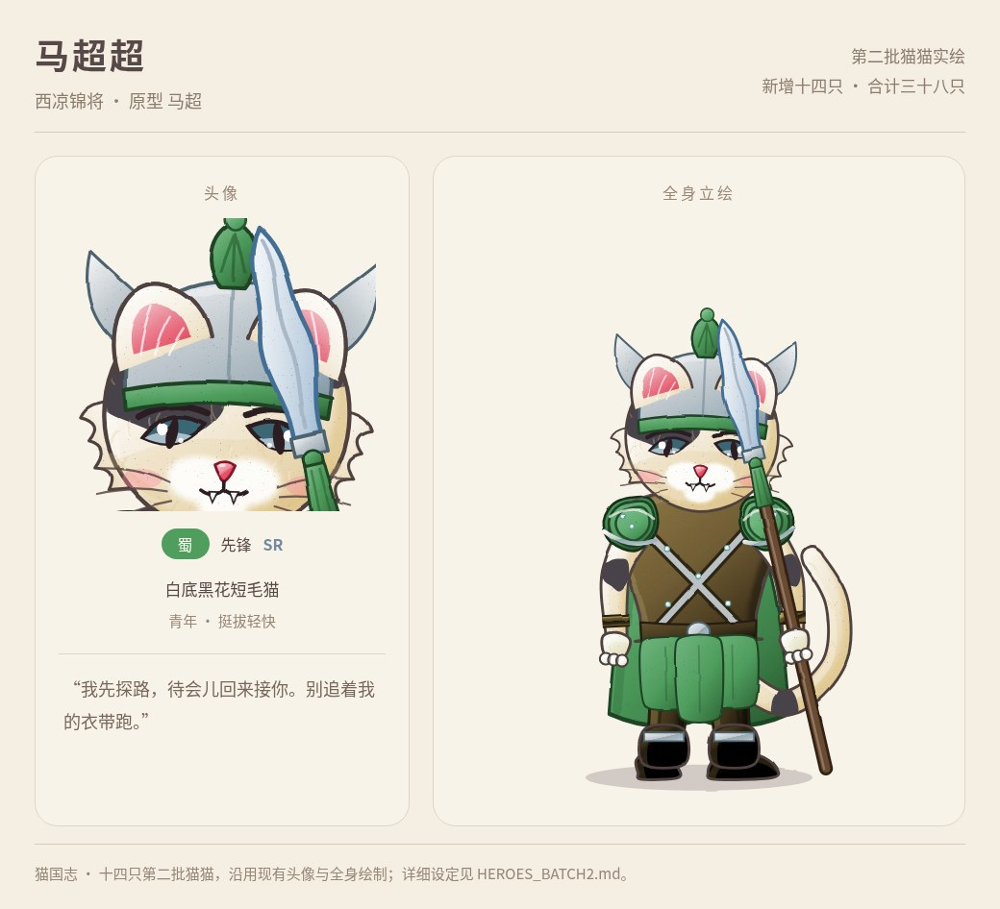

## 赵喵云 · 长坂护归将

`shu_zhaomiaoyun`｜蜀 · 刺客 · SSR｜原型：赵云

品种：纯白短毛猫；年龄与体型：青年 · 匀称轻捷；喜欢：干燥的纸篓、系稳的枪缨、点齐归来的小猫。

> 我绕后走。你看得见前路，就别急着回头。

背景（95 字）：长坂的路，他往返七趟，把迷路小猫连同滚走的行李一起送回营。银甲上落了泥，白毛也沾了灰，他只在意纸篓有没有淋湿。众猫问长枪为何系着细绳，赵喵云解开结：枪缨会乱，小猫抱过的绳头却认得回家的方向。

**外观**：纯白短毛、圆耳蓝眼与卷尾，银甲配绿内衬；通用长枪 `spear` 保留既有曲刃造型，文案只称长枪，不称专属龙胆枪款式。

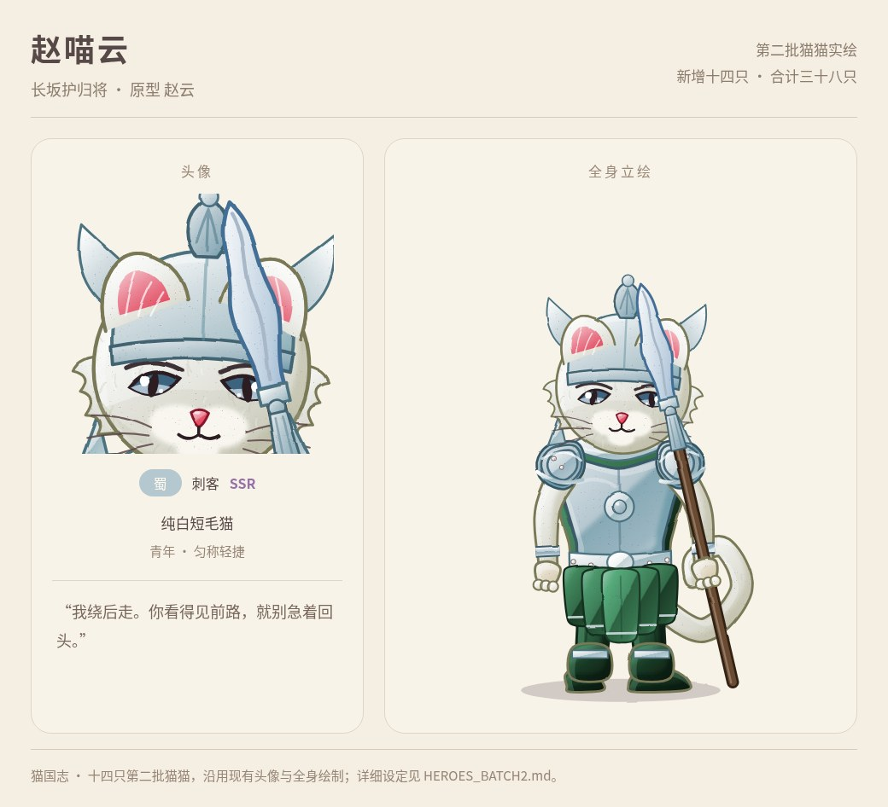

## 姜喵维 · 北望书生将

`shu_jiangwei`｜蜀 · 谋士 · SR｜原型：姜维

品种：浅棕暹罗猫；年龄与体型：青年 · 纤细端正；喜欢：写满边注的地图、结实的行囊、清晨辨路。

> 今日没走完，就把缘由记下。明日仍有路可走。

背景（99 字）：姜喵维的行囊总装着两张地图，一张画北路，一张写昨日没走成的原因。下雨、修桥、同行的猫鞋带松了，都记得仔细。他不催人，只把下一日的路线重新描齐；曾被问为何不换张干净纸，答说走过的弯路，也值得带在身上。

**外观**：浅棕重点色暹罗、尖耳长尾与纤细身形；银灰扣绿缘书生冠 `scholarCap`、文士袍 `robeScholar` 和通用长枪 `spear`，采用 Issue 明文许可的既有款式。

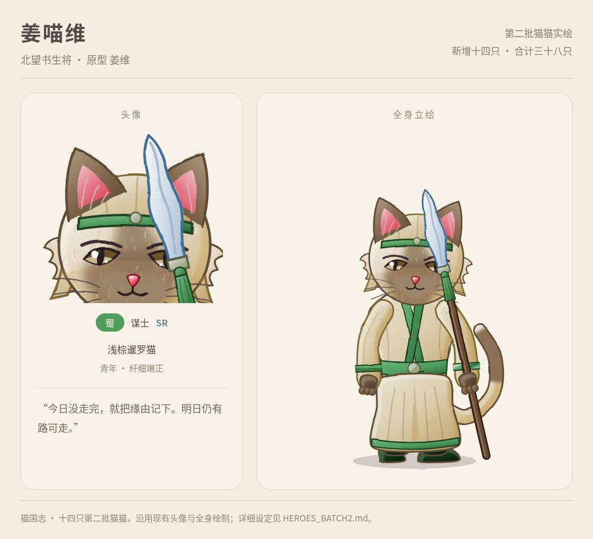

## 甘宁宁 · 锦帆铃侠

`wu_ganning`｜吴 · 刺客 · SR｜原型：甘宁

品种：黑色短毛猫；年龄与体型：青年 · 轻捷结实；喜欢：锦帆、颈铃、夜航后清点同伴。

> 我爪步够轻。铃铛若先报到，你就当它热情。

背景（96 字）：锦帆划过夜湾，岸上的猫先听见一串铃响，才看见甘宁宁的黑尾巴。他能把船绳系得悄无声息，偏不肯摘下颈铃：同伴要知道自己回来了。练身法时他常与铃铛商量，第一步轻些，第二步也轻些；铃铛每回都答得很响。

**外观**：黑短毛、尖耳长尾与轻捷身形；素银边赤红锦帆头巾、短褂和双钩 `hooks`；颈间单铃 `bell` 与腰间流苏 `tassel` 按 Claude 批准口径绘制，不称腰间铃圈。

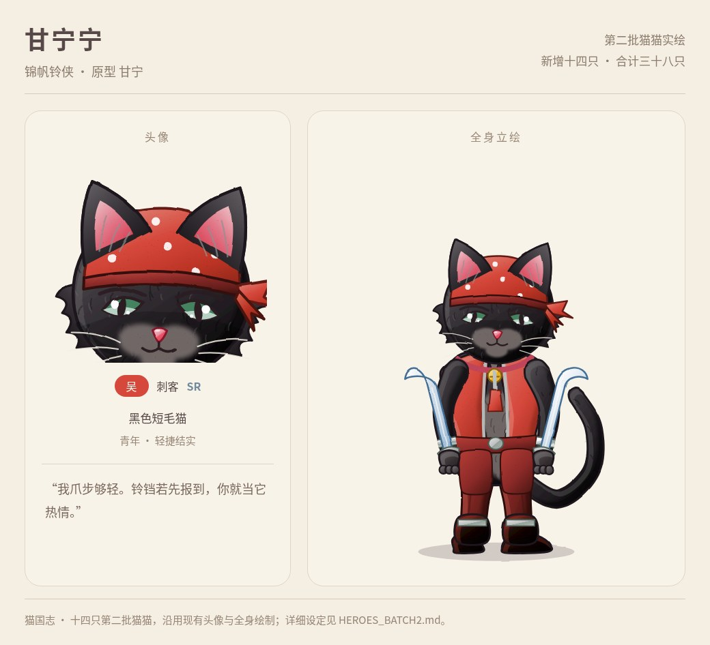

## 陆喵逊 · 夷陵筹火客

`wu_luxun`｜吴 · 谋士 · SSR｜原型：陆逊

品种：暖棕狸花猫；年龄与体型：青年 · 清瘦端正；喜欢：连营图、整洁批注、放回原处的羽扇。

> 火候由我算。退路留宽些，别拿尾巴量距离。

背景（90 字）：陆喵逊翻连营图时，会把风向和水桶的位置逐一圈好，点火总排在最后。他的字很小，军报像一群轻脚走路的猫。周都督嫌这位后辈太安静，送来一卷惊涛乐谱；他看完只添了八个字：此处宜先把琴搬走。

**外观**：暖棕细虎斑、折耳短尾与清瘦文士身形；书生冠、米白赤缘长袍与羽扇 `fan`，金属扣改用银灰，不加披风。

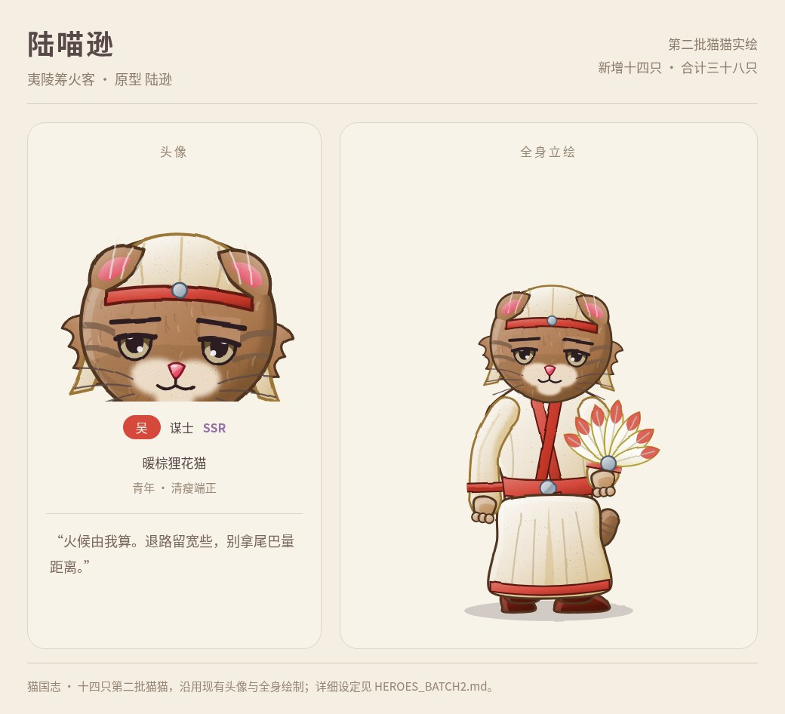

## 张角角 · 黄巾领队

`qun_zhangjiao`｜群 · 谋士 · SSR｜原型：张角

品种：黄色长毛猫；年龄与体型：壮年 · 蓬松修长；喜欢：黄巾小喵的点名册、修好的屋檐、晒干的头巾。

> 黄巾擦干再上阵。杖头真放不下这么多围脖。

背景（95 字）：乱世里，张角角带着黄巾小喵修屋送符水，一举法杖，队伍便围拢过来。后来他才知道，小喵们以为杖头是新添的晒巾架。于是每回点名先擦干黄巾，再讲正事；号令不曾变小，只是多了几声认真甩掉水珠的扑扑响。

**外观**：淡黄长毛、毛簇耳、紫眼与蓬尾；黄巾、银边紫缘道袍和法杖 `staff`。与首批仙族张爪的黑白毛、尖耳长尾与符箓区分；两者原型均按固定名单保留张角。

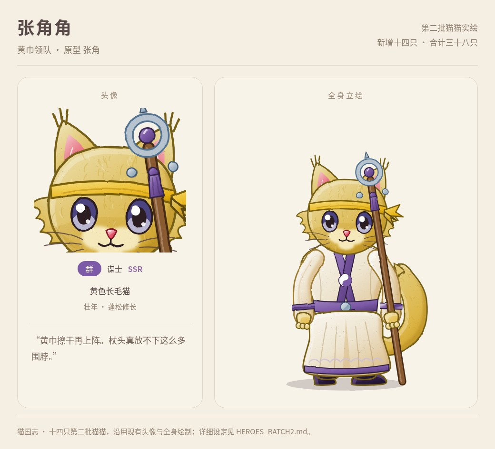

## 华雄雄 · 汜水威将

`qun_huaxiong`｜群 · 先锋 · SR｜原型：华雄

品种：深灰短毛猫；年龄与体型：壮年 · 结实高大；喜欢：第一声战鼓、磨亮的大刀、没有酒气的茶席。

> 先较量，后敬酒……能敬热茶么？

背景（97 字）：汜水关的华雄雄出阵总抢头一声鼓，刀往地上一拄，案边酒盏便齐齐晃动。真请他喝，他却会抱住刀柄犯困；所以同伴举杯越慢，他上前越快。每次回来，旁猫忙着问战功，他只压低嗓门问一句：那壶热茶，泡好了没有？

**外观**：壮硕深灰短毛、大耳长尾；素银边紫色将军盔与重甲，大刀采用现有长柄鱼骨偃月刀 `glaive`，无披风、光眼或亮金镶边。

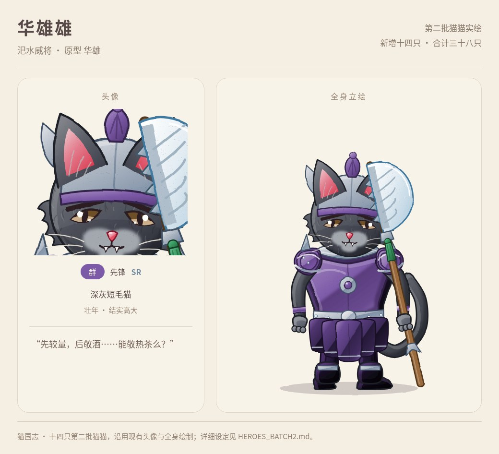

## 沙摩柯 · 五溪远射手

`man_shamoke`｜蛮 · 神射 · SSR｜原型：沙摩柯

品种：虎纹彩绘短毛猫；年龄与体型：壮年 · 敏捷长身；喜欢：山风、重新描好的战纹、图腾边的药草包。

> 风往左走，我就等它半步。近处还有这根骨朵。

背景（98 字）：五溪林间的树影，就是沙摩柯的练准靶。脸上战纹每天由自己重描，左右偶尔不齐，他说那是留给风的空位。骨朵一举，林风便把草香送远；图腾旁的叶包总收得仔细。同伴猜他在配秘药，揭开却先找到一根备用的骨朵绳。

**外观**：棕色虎纹彩绘短毛、尖耳卷尾与敏捷长身；橙带兽皮、灰银素骨色与面部战纹 `warPaint`，只持骨朵 `mace`，不画弹弓。

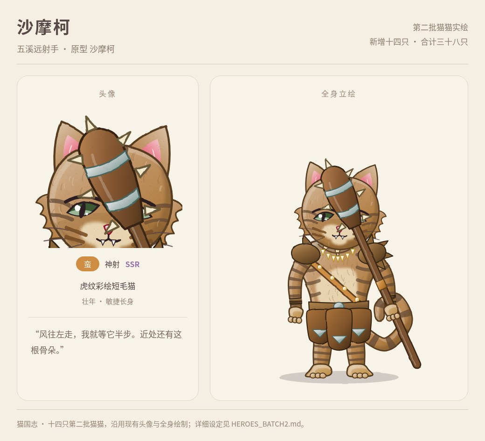

## 孟优优 · 山林献宝使

`man_mengyou`｜蛮 · 谋士 · SR｜原型：孟优

品种：胖玳瑁猫；年龄与体型：壮年 · 浑圆厚实；喜欢：旧猫抓板、大礼盒、背熟后倒着念的礼单。

> 此乃山林重宝。先挠两爪，再谈投诚。

背景（92 字）：孟优优出使，礼盒总比自己的腰还宽，揭开里面却是一块用了多年的猫抓板。他坚称抓得越久越珍贵，献礼时还附送一张如何挠得响的图。口上说顺路送礼，门口几只猫、屋里几处软席，早让他记得一清二楚。

**外观**：二色玳瑁 `tortie` 的深棕底、琥珀斑与暖棕口鼻，折耳蓬尾与浑圆体型；朴素橙褐短褂，无披风或光眼。献宝题材由小传与技能表现，不虚写已有猫抓板手持款式。

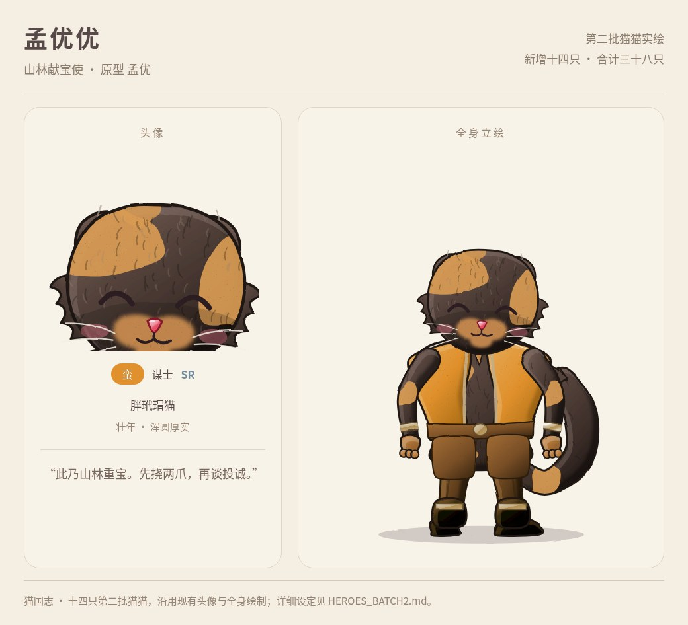

## 于吉吉 · 江东符水客

`xian_yuji`｜仙 · 谋士 · SSR｜原型：于吉

品种：银灰长毛猫；年龄与体型：老年 · 温厚匀称；喜欢：洁净的小壶、柳树下的长凳、梳开打结的毛。

> 符水慢慢喝，浮灰慢慢拂。轮到你了，不必挤。

背景（96 字）：江东巷口的银灰老猫，拂尘上总挂着替人扫下的柳絮，壶里的符水却从不落一点灰。来问吉凶的猫很多，他先请每位坐好，把打结的毛梳开。有人夸仙术高明，他捧着小壶眯眼笑：风有时也会帮忙，只是从来不肯洗壶。

**外观**：银灰长毛渐层、圆耳短尾与温厚身形；灰玉银边道冠、青白道袍、短白须和拂尘 `whisk`，与水镜喵的折耳文士袍区分。

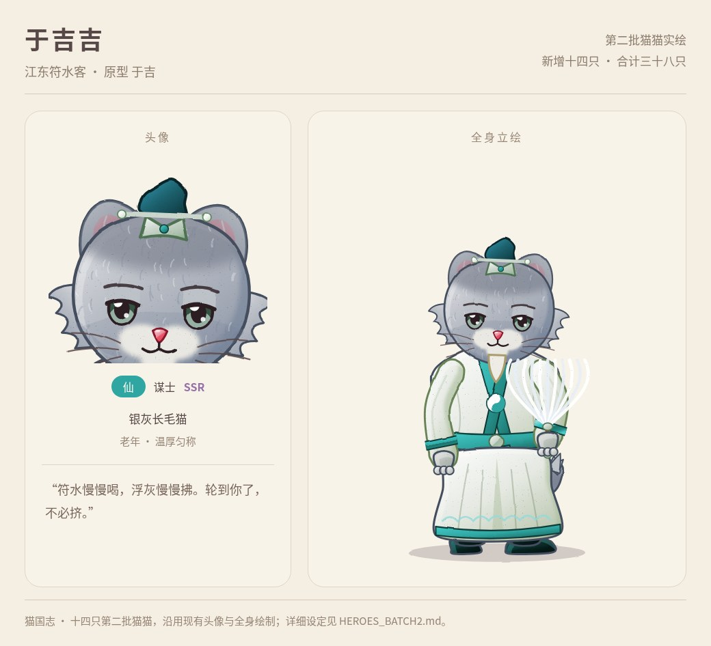

## 南华喵 · 梦蝶先生

`xian_nanhua`｜仙 · 医者 · SR｜原型：南华老仙

品种：蓝白蝶纹短毛猫；年龄与体型：老年 · 轻软圆润；喜欢：晒过的云被、松根旁的风、蝴蝶停留的午后。

> 梦里若找不到归路，就跟着这一声呼噜回来。

背景（98 字）：松根下的蓝白老猫，身上蝶形斑纹总让小猫猜他梦见了几只蝴蝶。南华喵替来客拢好云被，再把噩梦里的门留出一道缝。弟子问他何时醒来，他说要看梦中的被子晒干没有；于是观里晴天最忙的，反倒是负责晾被的那只猫。

**外观**：蓝白蝶斑 `butterfly`、大耳环尾与轻软圆身；额头蝶斑直接绘出，素灰玉边青白文士袍，无披风或光眼，与首批白猫、折耳猫和黑猫拉开差异。

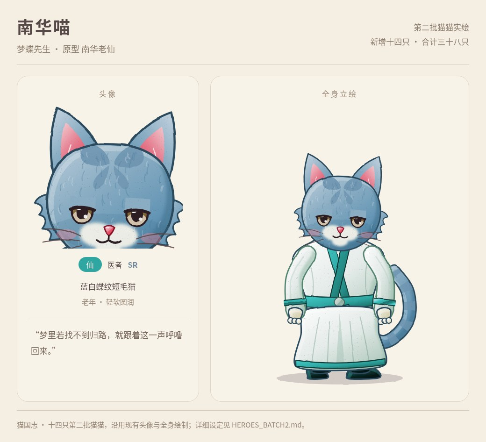

## 已批准的表现范围

沙摩柯只持骨朵；甘宁宁使用颈铃与腰间流苏；赵喵云使用通用长枪；马超超保留素色无金光披风。斧、双钩、拂尘、双短刀、二色玳瑁与蝶斑均引用 Claude 已补好的正式款式，不新增美术代码。

张角角的黄巾小喵采用当次协战，不在场上保留召唤单位。南华喵的九命保护按批准口径使用 `nine`、持续 99 次自身行动结束；能挡直接与持续伤害的致命一击，但可被净化。赵喵云的潜行使敌方单体选择优先避开自己，仍会受到范围技能影响；当场上没有其他可选目标时仍可被选择。这些取舍随技能说明展示，不把幻象闪避写成潜行。

十四只背景为 90～99 字，均满足 Issue 的 60～110 字范围；背景与台词各自唯一，未复制首批英雄完整句子。外观款式同时核对美术类型与真实绘制分支，头像保留原管线的常规裁切和前景道具。
