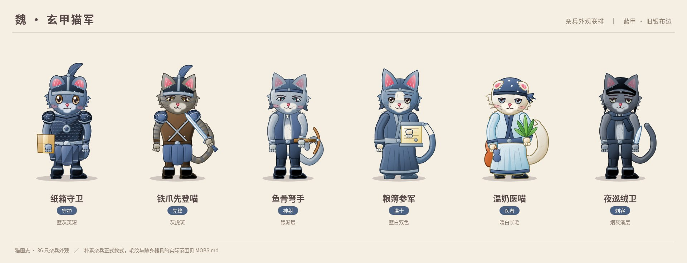
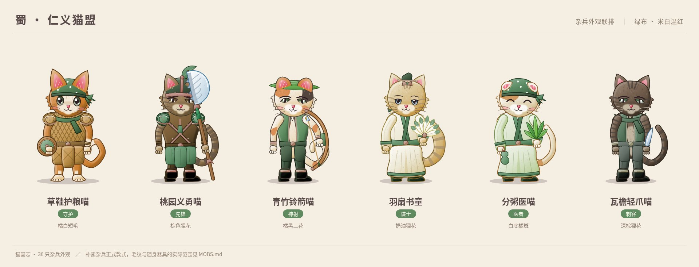
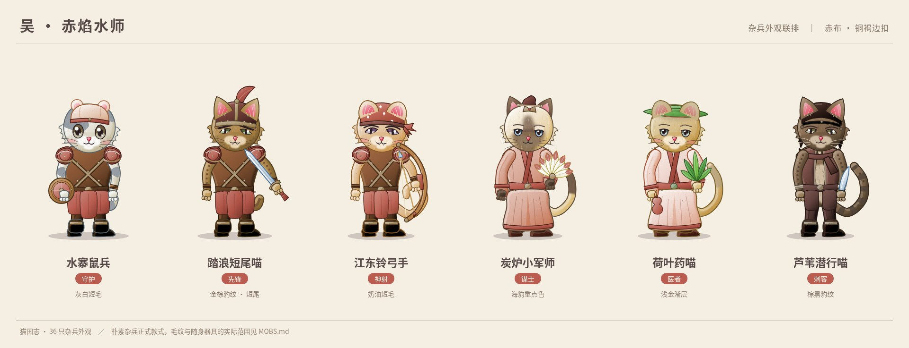
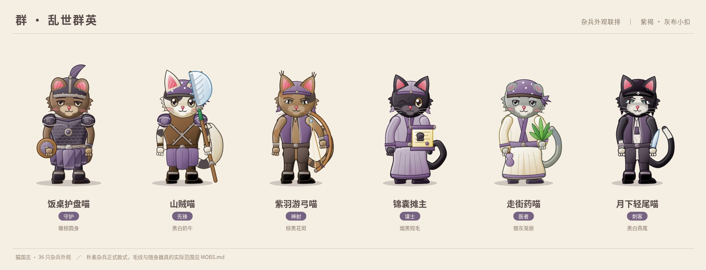
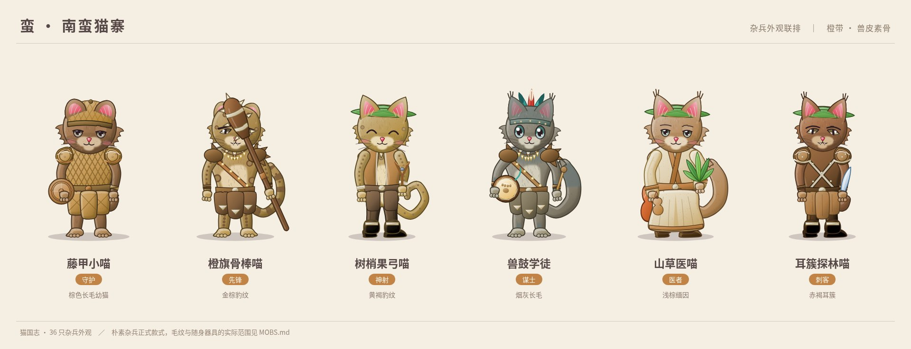
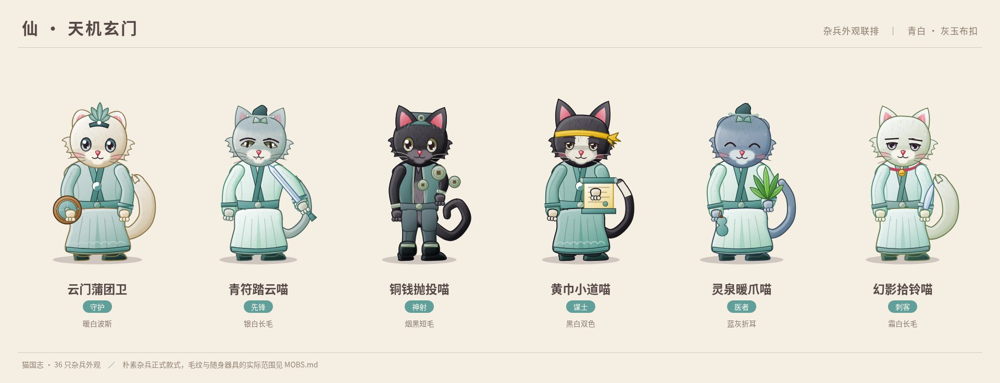

# 杂兵外观对照

36 只杂兵分别手写 `CatLook`，数据在 `src/data/mob-looks.ts`，由 `src/data/units.ts` 的 `MOB_LOOKS` 与 `lookOf` 统一提供。每阵营按守护、先锋、神射、谋士、医者、刺客排列。毛色、眼型、耳尾与身宽逐只设置，不再按名字的哈希拼装。

制服保留阵营识别：魏为蓝甲旧银，蜀为绿布米白与温红缝边，吴为赤布铜褐，群为紫褐灰扣，蛮为橙带兽皮与素骨，仙为青白灰玉。身宽在 0.88～1.12，头宽在 0.96～1.07；没有披风、长披肩、旗背、光眼、冕旒、雉尾冠或亮金制服边。

## 对照表

表中写的是当前已有款式实际绘出的东西。已按 Claude 在 Issue #26 的回复接入新增的朴素款式；与 `lookHint` 的具体物件仍有差别之处，在表后注明实际绘制范围。

| 名称 | 阵营 | 职业 | 毛色 | 配饰与装束一句话 |
| --- | --- | --- | --- | --- |
| 纸箱守卫 | 魏 | 守护 | 蓝灰纯色，浅灰口鼻 | 小玄甲盔配深蓝鳞甲，圆耳短尾，爪中纸箱盾带一枚肉垫印。 |
| 铁爪先登喵 | 魏 | 先锋 | 灰虎斑，冷灰细纹 | 蓝缨玄甲盔、玄色皮甲与单柄短剑，腰侧不加挂饰。 |
| 鱼骨弩手 | 魏 | 神射 | 银渐层，蓝灰毛尖 | 窄色蓝书帽和靛蓝短褂配小木弩，弩弦与箭身贴着右爪。 |
| 粮簿参军 | 魏 | 谋士 | 蓝白燕尾双色 | 深蓝书帽、旧银交领长袍，爪中卷粮簿有一枚圆印。 |
| 温奶医喵 | 魏 | 医者 | 暖白长毛 | 蓝布点纹药巾、浅蓝医袍，草药在爪，奶葫芦挂在身后。 |
| 夜巡绒卫 | 魏 | 刺客 | 烟灰渐层 | 蓝黑兜帽与贴身短褂绕一条细颈巾，单把短刀不带悬浮飞刀。 |
| 草鞋护粮喵 | 蜀 | 守护 | 橘白双色 | 绿头巾、草编护甲与绿颈巾配木圆盾，绿盾面衬着米白里布。 |
| 桃园义勇喵 | 蜀 | 先锋 | 棕色狸花 | 绿缨盔与温红布边轻甲，手持鱼骨长柄刀，胸前只留布穗。 |
| 青竹铃箭喵 | 蜀 | 神射 | 橘黑三花，米白底 | 青竹叶帽露出圆耳，翠绿短褂配木弓和铃箭。 |
| 羽扇书童 | 蜀 | 谋士 | 奶油狸花 | 小绿冠、米白绿边长袍，羽扇在前，地图卷在后。 |
| 分粥医喵 | 蜀 | 医者 | 白底橘斑 | 绿药巾与浅绿医袍，抱一束药草和小药葫芦。 |
| 瓦檐轻爪喵 | 蜀 | 刺客 | 深棕狸花 | 绿颈巾盖住瓦灰短衣的领口，轻装单把短刀适合走窄檐。 |
| 水寨鼠兵 | 吴 | 守护 | 灰白花斑 | 圆鼠耳帽戴在灰白猫头上，赤红短甲配木圆船盾。 |
| 踏浪短尾喵 | 吴 | 先锋 | 金棕豹纹 | 赤缨小盔、红边轻甲与单剑，短尾直接露出船卫身份。 |
| 江东铃弓手 | 吴 | 神射 | 奶油纯色 | 赤红点纹头巾与弓手轻甲，圆耳和卷尾陪着铃弓。 |
| 炭炉小军师 | 吴 | 谋士 | 海豹重点色 | 铜褐小冠与赤色学士袍，羽扇保留，炭炉尚无款式。 |
| 荷叶药喵 | 吴 | 医者 | 浅金渐层 | 宽沿叶药帽配淡红医袍，草药与小葫芦作随船药具。 |
| 芦苇潜行喵 | 吴 | 刺客 | 棕黑豹纹 | 暗红兜帽与夜行短褂配窄颈巾和短刀，背后不加芦苇斗篷。 |
| 饭桌护盘喵 | 群 | 守护 | 暖棕纯色 | 紫布色小盔和紫灰鳞甲衬着短尾圆身，木圆盾配紫灰盾面。 |
| 山贼喵 | 群 | 先锋 | 黑白奶牛花斑 | 旧紫头巾配褐色皮甲，抱一把鱼骨长刀，身后不挂战旗。 |
| 紫羽游弓喵 | 群 | 神射 | 棕黑花斑，棕底代玳瑁 | 紫褐短衣与灰紫书帽衬着细耳簇，曲木弓不加羽冠。 |
| 锦囊摊主 | 群 | 谋士 | 烟黑纯色 | 紫边书帽、灰紫旧袍与一本卷策，布穗表示摊主随身小物。 |
| 走街药喵 | 群 | 医者 | 银灰渐层 | 浅紫药巾和紫边米白医袍，草药配药葫芦随爪递出。 |
| 月下轻尾喵 | 群 | 刺客 | 黑白燕尾双色 | 暗紫兜帽露出猫耳，软短衣配紫布穗与单把短刀，背后不加披风。 |
| 藤甲小喵 | 蛮 | 守护 | 棕色长毛 | 圆藤盔、藤编甲与橙带配幼猫大头，木圆盾上留朴素橙扣。 |
| 橙旗骨棒喵 | 蛮 | 先锋 | 金棕豹纹 | 橙带兽皮装串着素骨珠，现有骨棒在爪，小旗不作背饰。 |
| 树梢果弓喵 | 蛮 | 神射 | 黄褐豹纹 | 宽沿叶帽配橙短褂，枝杈弹弓的弦绳跟着制服用橙色。 |
| 兽鼓学徒 | 蛮 | 谋士 | 烟灰长毛渐层 | 橙青羽冠配兽皮祭装，爪印兽鼓和小鼓槌都用现有款。 |
| 山草医喵 | 蛮 | 医者 | 浅棕长毛 | 叶药帽、橙边麻布医袍与草药，身后挂朴素水葫芦。 |
| 耳簇探林喵 | 蛮 | 刺客 | 赤褐纯色 | 叶帽上露出深色耳簇，橙棕皮甲配单把短刀，尾巴收得短。 |
| 云门蒲团卫 | 仙 | 守护 | 暖白长毛 | 青莲小冠与青灰厚道袍围住圆身，木圆盾的盾面用云门青色。 |
| 青符踏云喵 | 仙 | 先锋 | 银白长毛渐层 | 灰玉青冠和青白轻袍配单剑，云门制服不用英雄法杖。 |
| 铜钱抛投喵 | 仙 | 神射 | 烟黑纯色 | 青边小方帽与青灰短褂配三枚方孔铜钱，铜钱不带闪星。 |
| 黄巾小道喵 | 仙 | 谋士 | 黑白双色 | 黄布巾在头、青色道袍在身，手持卷轴，避免现有符箓黄光晕。 |
| 灵泉暖爪喵 | 仙 | 医者 | 蓝灰渐层折耳 | 青药冠和浅青医袍露出折耳，药草与葫芦代温泉药具。 |
| 幻影拾铃喵 | 仙 | 刺客 | 霜白长毛 | 浅青夜行袍挂一只日常小铃，单把短刀配空背，不画半透斗篷。 |

## 已批准的款式与实际范围

Claude 在 [替代方案答复](https://github.com/acaozixu123456/myRepository/issues/26#issuecomment-6106304792) 批准了朴素制服与器具取舍，随后在 [正式款式补充](https://github.com/acaozixu123456/myRepository/issues/26#issuecomment-6106319562) 要求本 PR 直接接入新增款式。本版已完成替换，不等待新增美术能力；二色玳瑁仍按该回复保留棕黑花斑替代。

没有新增或改写美术款式。头饰使用 `none`、`helmetWei`、`scholarCap`、`sailorBandana`、`taoistCrown`、`lotusCrown`、`rattanHelm`、`featherHeaddress`、`fortuneHat`、`yellowBand`、`ratCap`、`hood`、`leafHat`；衣装使用 `armorWei`、`armorLight`、`vest`、`robeScholar`、`robeTaoist`、`rattan`、`tribal`；背饰仅 `none`、`gourd`、`scrollBack`。手持道具使用 `shield`、`boxShield`、`crossbow`、`slingshot`、`dagger`、`coinsPlain`，以及既有的 `sword`、`bow`、`scroll`、`glaive`、`fan`、`herbs`、`mace`、`drum`。额外配饰限于 `scarf`、`tassel`、`bell`。

- 纸箱守卫使用 `boxShield`，纸箱现有图案是肉垫印，不宣称已有魏字。其余五名守护使用 `shield`，盾面随各阵营主色变化；它是木圆盾，不宣称已画出桃叶、荷叶、饭盘、藤编或云纹蒲团的专用造型。
- 鱼骨弩手使用 `crossbow`，树梢果弓喵使用 `slingshot`；其他弓手保留 `bow`。现有弩与弹弓已经可见，鱼骨纹、软箭头、软果球袋等没有独立字段，图例只描述实际绘出的木弩、枝杈弹弓与常规箭。
- 水寨鼠兵使用 `ratCap`，猫耳被帽子的圆鼠耳覆盖，角色始终是猫。魏、吴、群的夜行猫使用 `hood`；青竹铃箭喵、荷叶药喵、树梢果弓喵、山草医喵与耳簇探林喵使用 `leafHat`。其他布药巾保留现有头巾，灵泉暖爪喵仍用青色小道冠，不宣称已绘出专用药冠。
- 六名刺客都使用单把 `dagger`，没有悬浮飞刀。短刀的现有剑身仍为银灰色，不宣称已经绘出鱼骨、桃木、圆头或布包刃的专用材质。
- 铜钱抛投喵使用不带闪星的 `coinsPlain`；黄巾小道喵仍用 `scroll`，不用带黄色光晕的 `talisman`。普通小铃与弓自带的小铃保留原画法，局部黄铜色属于日常器具；没有光眼或亮金制服镶边。
- 药箱、奶壶、粥罐、贝壳药具、炭炉、药篓、纸伞、锦囊排、绒绳和腰袋尚无专用组合款式。沿用已批准的 `herbs` 自带药葫芦、`gourd` 和 `scroll` 表达药具或卷簿，图例不把它们写成已完成的专用物件。草鞋、补丁、桃花衣纹与藤绳也不虚写为独立字段。
- 兽鼓学徒使用现有羽冠、兽皮祭装、爪印兽鼓与鼓槌。橙旗骨棒喵的素骨珠由兽皮服自带，额带和手中旗尚未画出；制服保留橙带识别，背后不加旗。
- 紫羽游弓喵的二色玳瑁仍为替代毛纹：使用 `calico` 的棕色底、浅棕胸口和黑斑，现有模式并非独立二色玳瑁。紫羽帽饰也未虚写成已经绘出的专用品。
- 吴、仙刺客按 Issue 的朴素要求保持 `back: 'none'`，不加斗篷；其他杂兵也不使用披风、长披肩、旗背或英雄精英装饰。

## 联排截图

使用原 `src/art/cat.ts` 的 `catSvg` 输出，每只 SVG 作为独立图片，避免同页渐变与滤镜标识互相串色。临时预览放在 `.shots/`，不进入游戏路由。每张一行六只，保持完整画布、原站姿与纸纹滤镜；JPEG 小于 500KB。

## 校验

`tests/mob-looks.test.ts` 校验恰好覆盖全部 36 个杂兵、对象与完整外观无重复、款式同时存在于美术契约和真实绘制分支、颜色与体型有效、没有披风或精英装饰，并检查新增盾牌、弩、帽饰、短刀和无闪星铜钱的对应关系；逐只调用原 SVG 绘制检查无无效数值。英雄外观与未知单位的原报错行为也有回归校验。

提交前运行 `npm run typecheck && npm test`。
