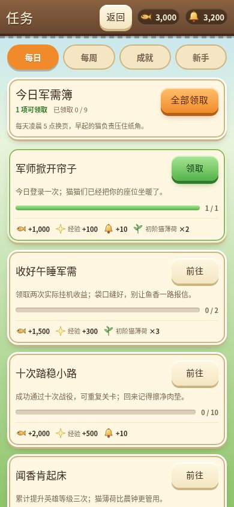
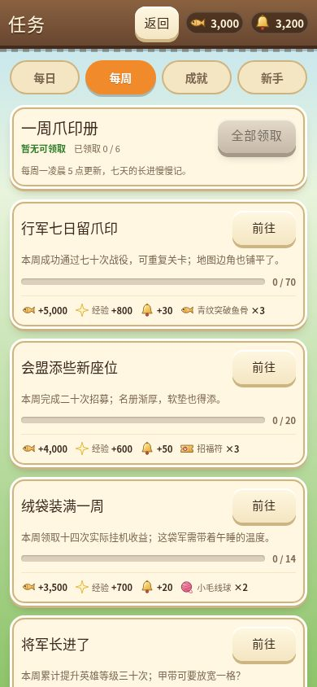
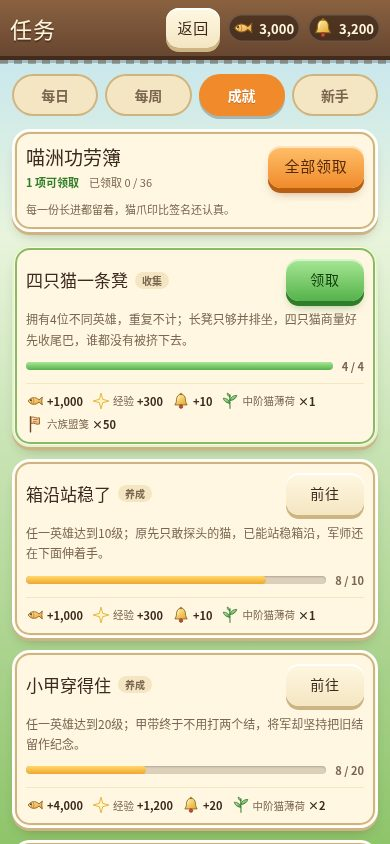
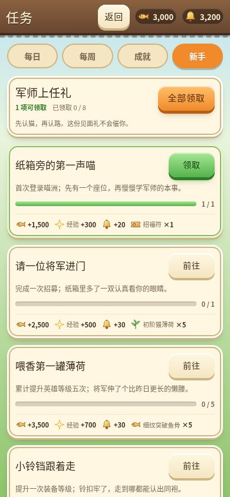
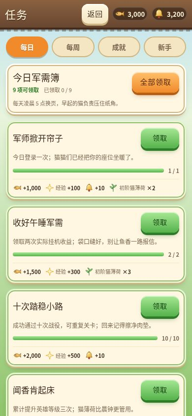
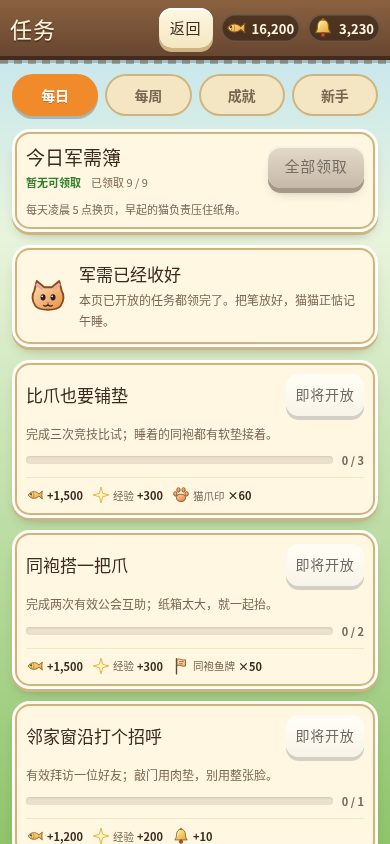

# 任务系统（Issue #27）

主城三项行动按钮下的「任务」入口打开全屏二级页。红点表示至少一项已开放任务可领取；返回主城时重新计算。任务定义与奖励仍来自 `src/content/economy.ts` 的 90 项 `QUESTS`，界面不新增活跃度或货币。

## 进度、周期与领取

`PlayerState.quests` 保存每个任务 id 的 `progress` / `claimed`，以及本地日期的 `dailyKey` / `weeklyKey`。旧存档迁移时补齐缺失任务字段；跨周期的日常、周常记录不会沿用。成就、新手任务永久保留。新任务奖励直接入现有账本，不再写入 `pending`。

`track(s, goalType, amount)` 将真实成功操作记入尚未完成的同类任务。战役最高关卡、英雄最高等级、不同英雄数量取最大值；其余目标累加，统一截断到目标值。每天本地凌晨 5 点重置每日任务，周一本地凌晨 5 点重置每周任务。任务与商店共用 `src/game/periods.ts`，使用本地日历计算以适配夏令时。

`claim(s, questId)` 检查开放状态、进度和领取记录后发放整份奖励；失败不发部分奖励，也不占用领取机会。成功返回实际 `RewardDef`。UI 随后保存存档、刷新列表及顶栏，并用现有 toast / floaty 反馈实际领取数量。列表刷新保留滚动位置。

奖励按 [Issue #27 的评审答复](https://github.com/acaozixu123456/myRepository/issues/27#issuecomment-6106305363) 入账：小鱼干、成长经验、金铃铛直接记入 `res`；猫薄荷小、中、大规格按 1/4/16 折入 `res.catnip`，普通招福符记入 `res.tickets`。毛线球和其余目录道具通过已有 `addItem` 入库，小毛线球保留 `res.yarn` 别名，中、大毛线球及材料、宝箱、通用碎片等保留具体 id。背包满或任一道具超堆叠上限时，整份奖励拒领，保留领取机会。

成功强化每次记录一个 `equip_upgrade`；爬塔仅在 `towerClear()` 返回首次奖励时记录一个 `tower_clear`，重复塔层不计。`clear_stage` 只计主线胜场，包含主城挂机，不含爬塔。竞技、公会、好友任务仍未开放。

旧 `pending` 按 [确认的防丢例外](https://github.com/acaozixu123456/myRepository/issues/27#issuecomment-6106448503) 迁移：目录内有效道具逐项并入对应账本，成功后删除条目，全部迁完删除字段。超堆叠条目保留原数量，下次读档再试；新任务奖励不写入该字段。无目录定义或无效数量的旧坏条目不保留。保存后再次加载不会重复发放。

## 界面行为

- 四页签为每日 12 项、每周 8 项、成就 60 项、新手 10 项；当前页签保存在模块 `questState.tab`。
- 可领取排最前，其后是进行中、未开放任务，已领取任务灰色沉底。同组保留任务定义的顺序。
- 每项显示任务原名、原描述、目标进度条和实际奖励图标；成就附原有分类。未开放任务显示「即将开放」并禁用操作。
- 「全部领取」只领取当前页签中可以领取的任务，汇总成功结果，不操作其他页签。没有可领取任务时按钮禁用。
- 当前页已开放任务都领取后，显示「军需已经收好」，保留已领取及未开放条目，便于查看。
- 「前往」使用已有界面：养成 / 技能 / 小鱼干消耗前往阵容，招募 / 英雄收集前往招募，装备强化前往背包。战役明确打开征战的主线页，爬塔明确打开爬塔页，覆盖上次留下的页签状态。

主入口、四个页签、领取 / 全领 / 前往 / 返回按钮均至少 40px，使用现有木纹 `topbar()`、羊皮纸 `.panel`、`.seg` / `.pill`、`.bar` / `.btn` 和手绘 SVG。新增样式集中追加为 `qst-` 前缀，未更改 UI Kit 或战斗、美术、特效文件。

## 验收

浏览器临时脚本 `.shots/quests-verify.mjs` 使用本机 Chromium，以 390×844 检查四页签、按钮尺寸、横向溢出、真实单领 / 全领数值、当前页隔离、保存与刷新、重新载入领取记录、未开放按钮、跳转和主城红点。领取场景使用隔离的进度 fixture，不修改产品任务数据，也不预置已领取标记。

另已实测跨凌晨 5 点的点击边界：停在昨日已完成的战役任务上，5 点后先点击旧「领取」按钮，点击入口先换日、记录一次登录并保存刷新。昨日战役进度与界面均归零，旧领取动作不发奖励；1500ms 后进度仍正确，登录仍只记一次。其他点击同样先处理周期变化，避免定时器漏掉已经被点击同步的刷新。

默认完整场景已通过：每日 9 项、每周 6 项、成就 36 项、新手 8 项，共 59 个已开放任务的奖励均通过真实单领或当前页全领取得。逐项核对小鱼干、成长经验、金铃铛、猫薄荷、招福符和全部库存道具；完成截图来自实际领奖后的状态。其余 31 项保留「即将开放」。

验收还覆盖重复点击只入账一次、鱼骨材料满栈及 `res.catnip = 9999` 的整单原子拒领、腾位后再次成功领取、五类「前往」与主线/爬塔页签覆盖、实际商店小鱼干支出只计一次、存档重载和主城红点。新按钮均不小于 40px，无横向溢出、无页面错误。

最终提交前运行 `npm run typecheck && npm test`。六张截图均为 JPEG，小于 500KB：

| 每日 | 每周 |
|---|---|
|  |  |

| 成就 | 新手 |
|---|---|
|  |  |

| 可领取 | 已开放任务全部领取 |
|---|---|
|  |  |
