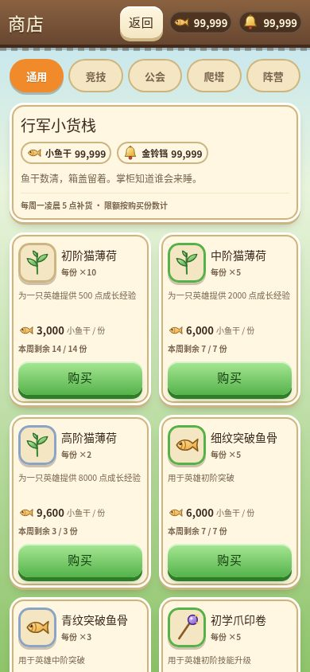
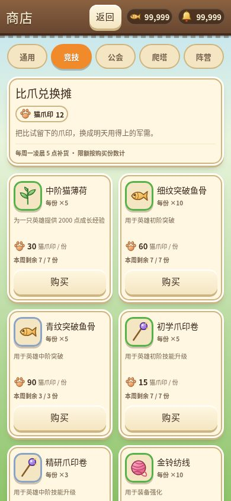
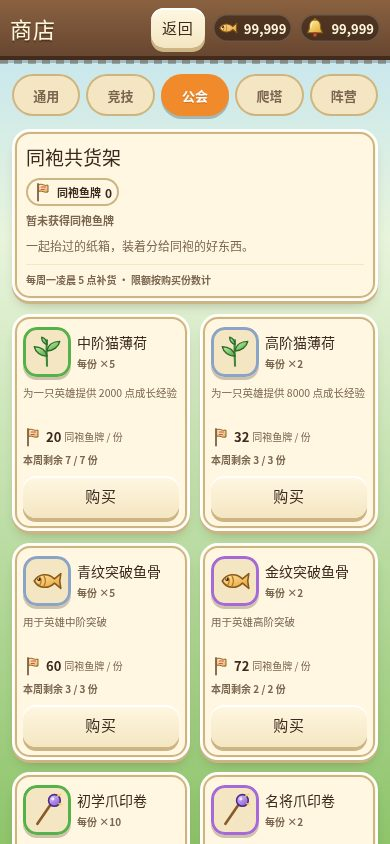
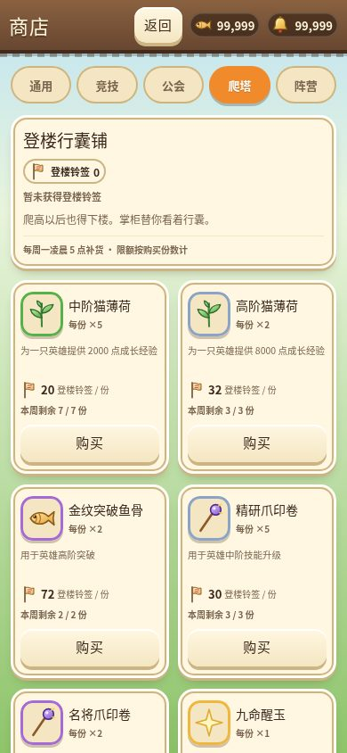
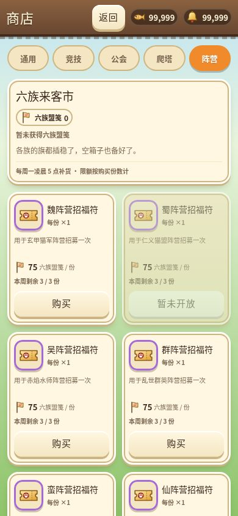
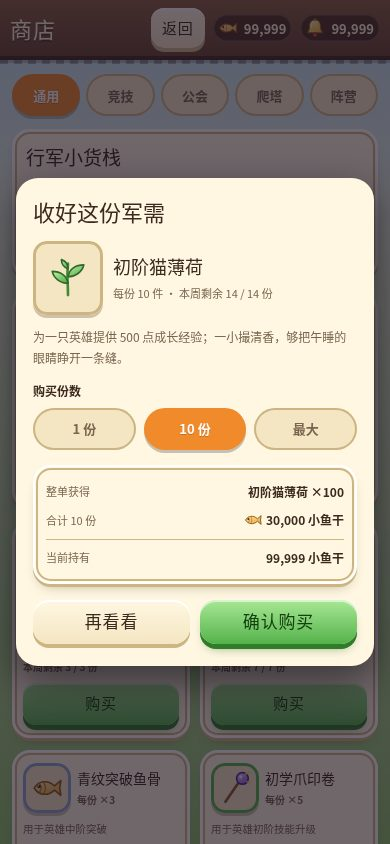
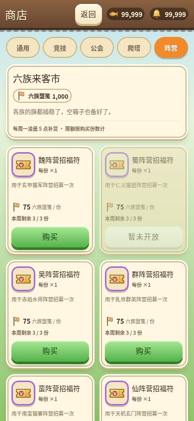

# 商店（Issue #28）

主城「每日福利」下一排的小入口打开全屏商店，入口容器支持与任务入口并排。通用、竞技、公会、爬塔、阵营五页签均显示原目录十二件商品，总计六十件。商品与价格来自 `SHOP_ITEMS`，准备状态来自 `SHOP_ITEM_READINESS`，没有新增兑换比例、出售功能或货币来源。

## 数量、限额与账本

购买数量指**份数**，每份道具数量为 `offer.item.count`，周限额也按份数累计。例如十份通用初阶猫薄荷实际得到一百份初阶猫薄荷、花费三万小鱼干，并占十次周配额。

`listShop(s, shopId, now)` 为只读查询，返回可售状态、货币余额、已购份数、周剩余及 `maxCount`。最大可购数统一受余额、库存容量与周限额约束，界面不另写计算规则。跨周查询按新周的零已购投影，不修改存档。

`buy(s, offerId, count, now)` 接收商品条目 id，校验准备状态、整份数量、货币、限额及入库容量。成功才同时扣币、入库并更新 `s.shop`；任一失败保留整个玩家状态，返回中文原因。返回值的 `item.count`、`cost.count` 是整单实际收支，UI 保存后刷新货架及顶栏，用现有 toast / floaty 反馈。

普通小鱼干、金铃铛直接使用资源账本；猫爪印、同袍鱼牌、登楼铃签、六族盟笺使用现有库存。未取得这些货币时显示「暂未获得」，不能借用小鱼干或金铃铛支付。库存已有别名保持一致：初阶猫薄荷 / 普通招福符 / 小毛线球分别入 `res.catnip` / `res.tickets` / `res.yarn`；中高阶猫薄荷、其他材料、阵营符、宝箱与通用碎片保留具体道具 id 入背包，不自动开启或消耗。

`PlayerState.shop = { weeklyKey, bought }` 不提高存档版本，旧存档补空记录。周一当地凌晨 5 点换周，采用本地日历回退以适配夏令时。任务系统尚未合并，本次独立导出 `shopWeeklyKey()`；未来可由主导统一周期工具。读档迁移或新周首笔成功购买写回周记录，失败购买不提前写回。

## 购买界面

五个 `.seg` 页签、羊皮纸商品卡、品质边框与手绘 SVG 复用现有 UI Kit，新增样式统一 `shop-` 前缀。商品显示每份数量、货币价格及周剩余；蜀阵营招福符准备状态为假，显示「暂未开放」且禁用。限购用完显示「本周售罄」。

购买前打开独立 `.dialog`，选择一份、十份或当前最大份数，查看整单道具数、总价和当前余额。无法买十份时禁用十份；没有足够余额时仍可查看商品与原因，确认按钮禁用。确认窗口里的普通点击保留窗口，背景或「再看看」关闭；取消、选数量都不扣币。成功立即关闭原确认窗口，避免同一按钮重复入账。

所有新增点击目标至少 40px。完整购买保留列表滚动位置；错误反馈直接使用逻辑返回的原因。全程无新增依赖、位图、emoji 或 AI 图，不改 UI Kit、战斗、美术、特效和内容契约。

## 验证与截图

商店的 46 项逻辑测试已通过，覆盖完整目录、扣款、库存别名、份数限购、跨周与旧存档、禁售、无币、满仓和失败原子性。提交前运行完整 `npm run typecheck && npm test`。

浏览器临时脚本 `.shots/shop-verify.mjs` 使用本机 Chromium 与独立存档，实测通过 390×844 下的五页签、真实一份 / 十份 / 最大购买、重复点击、取消无扣款、余额变动后的原子失败、READINESS 禁售、周一 04:59 / 05:00 换周及重新载入。新点击目标均不小于 40px，无横向溢出、无页面错误。截图存档已完成新手引导，七张 JPEG 均小于 500KB：

| 通用 | 竞技 |
|---|---|
|  |  |

| 公会 | 爬塔 |
|---|---|
|  |  |

| 阵营 | 确认购买 |
|---|---|
|  |  |

