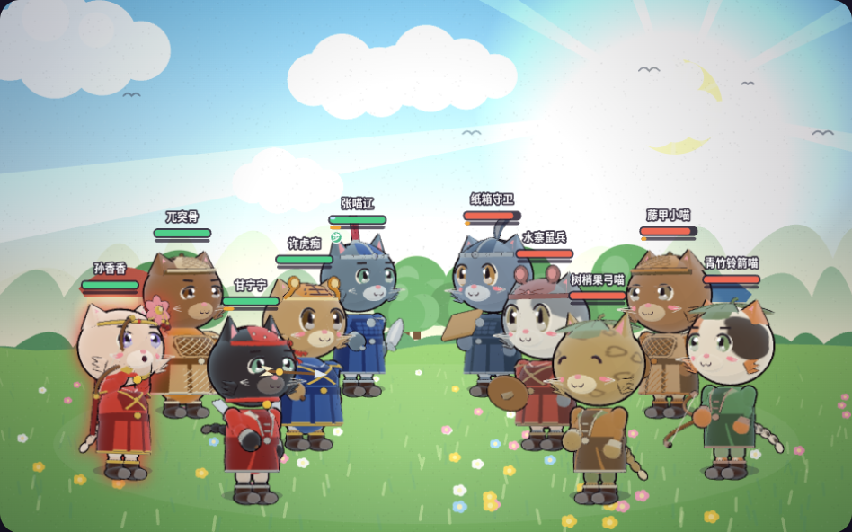

# 战场衣服第 3 批：魏甲、轻甲、短褂、藤甲

四件底版现在分别有规整札片、X 绑带、开襟翻领和交错藤编。肩胸归 torso；腰下通过既有 `userData.skirt` 挂 hip。腰口 y=.57 保持不动，构建时把上身几何收至 .90，为大头杂兵低头和呼吸留出壳面间隙；根变换保持单位。

固定对照基线：`e777d58f3b0e9965f7af25ded73948a84e68d219`。官图使用原样官方 `src/dev/cat3d.ts`，完整源树复制到唯一临时目录，按 `shots3d` 同一入口、参数和 Playwright 流程截图。图中已使用当前 armedR=-20、右肘基础-.5、无武器右臂-4与左臂基础-6的站姿，以及眯眼 / 张嘴表情。

## 所有使用者与预算

共29位使用者：9英雄、20杂兵。12宠物均为 `body=none`。

| 部件 | 使用者 | 逻辑网格，含 skirt | 实际网格，含描边 | 最大分段 |
| --- | --- | ---: | ---: | ---: |
| `armorWei` | 张喵辽 `wei_zhangliao`；`mob_wei_guard`, `mob_qun_guard` | 22 | 42 | 24 |
| `armorLight` | 许虎痴 `wei_xuhuchi`、黄忠忠 `shu_huangzhong`、马超超 `shu_machao`、孙小霸 `wu_sunxiaoba`、孙香香 `wu_sunxiangxiang`；`mob_wei_vanguard`, `mob_shu_vanguard`, `mob_wu_guard`, `mob_wu_vanguard`, `mob_wu_archer`, `mob_qun_vanguard`, `mob_man_assassin` | 22 | 42 | 24 |
| `vest` | 甘宁宁 `wu_ganning`、孟优优 `man_mengyou`；`mob_wei_archer`, `mob_wei_assassin`, `mob_shu_archer`, `mob_shu_assassin`, `mob_wu_assassin`, `mob_qun_archer`, `mob_qun_assassin`, `mob_man_archer`, `mob_xian_archer` | 15 | 29 | 24 |
| `rattan` | 兀突骨 `man_wutugu`；`mob_shu_guard`, `mob_man_guard` | 22 | 38 | 24 |

所有材质复用 `toon / outline` 缓存，节点缩放与行列式为正。魏甲15块札片合为一网格；藤条每一斜向合为一个网格，交点前后层差由相反的±.007起伏形成。形状处理均在构建时进行。

## 官方三姿势与小尺寸

各图每行依次为 idle / windup / strike；phase=0、t=.4、yaw=32。大图单格290×254，小图单格250×219，猫主体约190px高。直接按4～5行分组生成，保留每张原始浏览器PNG的完整尺寸和像素，未缩图或二次裁切。

| 分组与行顺序 | 大图 | 小尺寸 |
| --- | --- | --- |
| 英雄1：张喵辽、许虎痴、黄忠忠、马超超、孙小霸 | [heroes-1](heroes-1.png) | [heroes-1-small](heroes-1-small.png) |
| 英雄2：孙香香、甘宁宁、孟优优、兀突骨 | [heroes-2](heroes-2.png) | [heroes-2-small](heroes-2-small.png) |
| 杂兵1：`mob_wei_guard`, `mob_wei_vanguard`, `mob_wei_archer`, `mob_wei_assassin`, `mob_shu_guard` | [mobs-1](mobs-1.png) | [mobs-1-small](mobs-1-small.png) |
| 杂兵2：`mob_shu_vanguard`, `mob_shu_archer`, `mob_shu_assassin`, `mob_wu_guard`, `mob_wu_vanguard` | [mobs-2](mobs-2.png) | [mobs-2-small](mobs-2-small.png) |
| 杂兵3：`mob_wu_archer`, `mob_wu_assassin`, `mob_qun_guard`, `mob_qun_vanguard`, `mob_qun_archer` | [mobs-3](mobs-3.png) | [mobs-3-small](mobs-3-small.png) |
| 杂兵4：`mob_qun_assassin`, `mob_man_guard`, `mob_man_archer`, `mob_man_assassin`, `mob_xian_archer` | [mobs-4](mobs-4.png) | [mobs-4-small](mobs-4-small.png) |

9英雄均补拍三姿势的正面、反侧和背面，行顺序与上表两组相同：

| 朝向 | 英雄1 | 英雄2 |
| --- | --- | --- |
| yaw=0 | [front](heroes-1-front.png) | [front](heroes-2-front.png) |
| yaw=-32 | [reverse](heroes-1-reverse.png) | [reverse](heroes-2-reverse.png) |
| yaw=148 | [back](heroes-1-back.png) | [back](heroes-2-back.png) |

[大头领口](neckroom-large-heads.png)：`mob_shu_archer`, `mob_wu_guard`, `mob_man_guard`, `mob_man_archer`，每行 idle / slump / strike，yaw=0，单格290×254。低头时领口及衣服描边已留出间隙。[藤编细节](rattan-front-detail.png)：兀突骨、蜀守卫、蛮守卫，idle / windup / strike，yaw=0，单格360×315。图中保留现有盾和爪部动作；抬手时它们会覆盖部分口鼻。

## 真实十猫战斗

原样官方 `src/demo/battle.ts`，`test=1&r3d=1&theme=meadow&seed=2`。我方为张喵辽 / 许虎痴 / 甘宁宁 / 兀突骨 / 孙香香；敌方为 `mob_wei_guard / mob_wu_guard / mob_man_archer / mob_man_guard / mob_shu_archer`。全部10名均属本批29名使用者，实际 `actor.rig.cat3d` 为10/10；四种 `field-*-armor / field-open-vest` body组与对应 skirt 组逐只命中。

以1/60秒步进 Scene，每tick让出微任务，保留官方 `advance` 的编排调度；3.00秒后每15tick留一帧，共12帧3.25～6.00秒。选第04帧，记录 `scene.time=4.24999999999999`（4.25秒），10名仍在场，保留角色名与血条。980×800窗口容纳整个画布，截图取完整 `#cv` 矩形；没有图像后处理裁切或缩放。完整原始12帧只留临时目录，时间、阵容、body组命中与SHA见 [采集记录](capture-records.json)。

脚本错误为0。原页面外链 Google Fonts 有1次 `net::ERR_TUNNEL_CONNECTION_FAILED`，使用本机字体完成截图；该失败完整记录，未作为3D成功请求计数。

## 参考与保留的限制

实际查看 `assets/heroes/ref/` 中这9名英雄的JPG，与 `docs/ART_PROMPTS.md`、当前 `src/data/heroes.ts` 的配色和lore核对：张喵辽是蓝色制式甲与银色胸镜；轻甲按许虎痴、孙小霸、孙香香、黄忠忠、马超超的短肩与X绑带；甘宁宁与孟优优保留开襟短褂；兀突骨保留暖藤色与菱形篮编。主色 / 辅色 / 镶边 / 布料取实际 `PartCtx.pal`；杂兵仍使用各阵营的原配色。原参考文件SHA记录在独立QA与采集记录中。

最不满意的是190px级别藤编的上下穿插深度仍偏弱；背面是暖藤色完整底壳，辨识主要依靠前胸、前腰和肩片。魏甲小札片在缩小时也主要读作规则色块，侧后视更依靠肩层和胸镜。

## 源码、无损导出与验证

| 来源 | SHA256 |
| --- | --- |
| body注册 `body.ts` | `deff4ede63cecfff2513149843d01dbb48c570689658a66a60413c64daae959a` |
| `body-field-armor.ts` | `1735d0cbbb9095bdcf995a91fb9cd406c0096d9882b885f341b970081b012942` |
| body → helper path+NUL+bytes+NUL 合成 | `74787654cae61640cc5634965b8a27632c87182271e3ea123156a13e8201918d` |
| `cat3d.ts` | `39b82bcb153baf7a1c0131fc39b1b42dccddce44d69a1724ccbcd04535a62aa4` |
| `pose.ts` | `3abe84b540c541d2637a36e7291c599d9b5a52318d4524662f122ce803e6431c` |
| `actor.ts` | `268bc636c0ea4271432c0b0428105e66c204cb6fb5c3739ccb7c0aabb38f238f` |

官图每页浏览器都校验body / helper / cat / pose / actor的SHA哨兵。20项衣服、引擎、数据与官方入口依赖在采集前后SHA相同；哨兵仅新增unused export，不改变节点、几何、材质或正常bake。所有20张PNG只调整无损压缩参数；逐张解码完整RGBA数组，模式、尺寸一致，变化像素0。战斗WebP为 `lossless=True / quality=100 / method=6 / exact=True`，解码RGBA也与完整原始PNG逐像素一致。全部文件小于500,000字节；[采集记录](capture-records.json) 给出每张原始/导出SHA、像素SHA、尺寸、输入参数、错误与大小。

[独立正常前后对照](before-after.png) 左旧右新，共用e777当前引擎，normal bake，idle/t=.4/phase=0/yaw32，250×219单格。旧 `BODY` 来自真实 `git show e777d58:src/art3d/parts/body.ts`，并经唯一模块SHA哨兵核对。独立图重压缩RGBA像素差0，SHA `7507a248c589f7b7f9c6d7b188153a7146a10159dacc6ad373e3bb99ff7390d0`。其 [独立审核说明](qa-summary.md) / [机器报告](qa-summary.json) 由reviewer独立生成，本次官图没有改动三文件。

作者与独立QA均使用最终1735d0源：29×(14姿势×4朝向+3姿势×12时刻)=2,668个状态。衣服实体和沿normal展开的描边对真实1,120个颅骨三角裁剪交叉均0；眼睛实际12×12采样ID与动态鼻口5点新增遮挡0；非有限值、自衣服出FRAME及新增整猫裁切 / 幅度增加均0。鼻口来自当前nose / muzzle及启用的smile或mouthO表面，含1,972个mouthO与696个smile状态；每眼最低有效样本为全角50、动画70。共同刚体yaw不改变实体交叉，投影遮挡和FRAME按每个朝向单独计算。

整猫仍保留双方相同的184个静态、93个动画裁切状态（合计277），来自现有headTop / paw；最大y=3.755856928、最小y=-.290644194，FRAME y=[-.25,3.6]。有限姿势与时刻不证明所有连续时刻都无交叉。60名非目标的所有蒙皮attributes与index原始字节相同，六款已通过衣服函数及body-robes helper与基线字节相同。

最终 source 的 `npm run typecheck && npm test` 已通过：68个文件、1,019项测试，退出0。未新增测试或依赖。

维护者在提交前另同步主线 `29f6a8bbe66bbcf4ea1c0119675cac65f8c4e00a` 的日期测试修复，实际再次执行同命令，退出0、68文件/1019测试全部通过，完整日志 `.shots/body-field-official/tests-main-29f6.log`。与 e777 拍摄基线相比，相关 art3d、英雄/杂兵/宠物 look、actor/player 源码没有变化；两份本批源文件、22图及独立QA三件字节保持冻结记录。正式图与独立报告仍明确捕获于 e777。
