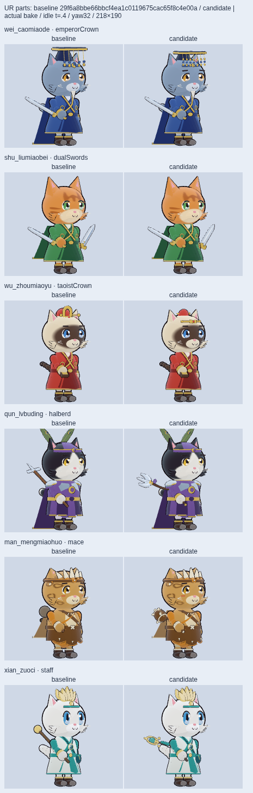

# UR 六只专属部件：独立 QA

可以提交 Claude 审阅，当前没有阻塞项；此结论仅覆盖下述有限样本，未声称 Claude 已通过。本轮只写两个 QA 文件及正常烘焙 `before-after.png`，未改源、姿势、引擎、数据或进度。

基线为 `29f6a8bbe66bbcf4ea1c0119675cac65f8c4e00a`；通用 WEAPON 与 HEADGEAR 直接取该提交 `git show` 原始 bytes，候选与基线使用同一最新 `cat3d.ts` (`39b82bcb…`) 与 `pose.ts` (`3abe84b5…`)。完整 src 339 文件复制到唯一不可变 `/tmp` 快照，29 个实际运行源导入全部指向该快照；四美术源与 18 依赖拍前拍后 SHA 不变，完整快照逐文件也未变。最终四源按 `[heroes,regalia,Liu,weapons]` **直接拼接 bytes** 的 SHA 为 `75b79a46c1fabae8ac82a057931013a01cc60a0330ceafa073f38aa9fa0a58ea`，不是 path-NUL 摘要；后者单独存 JSON。本报告与对照图全部由此最终版本重新采样。

| 正式使用者 | 覆盖 | 逻辑网格 | 含描边物理网格 | 最大分段 |
| --- | --- | ---: | ---: | ---: |
| 曹喵德 `wei_caomiaode` | headgear | 12 | 23 | 20 |
| 刘喵备 `shu_liumiaobei` | weapon，两手 | 16（各 8） | 30 | 12 |
| 周喵瑜 `wu_zhoumiaoyu` | headgear | 10 | 20 | 20 |
| 吕布丁 `qun_lvbuding` | weapon | 13 | 24 | 12 |
| 孟喵获 `man_mengmiaohuo` | weapon | 17 | 33 | 16 |
| 左慈喵 `xian_zuoci` | weapon | 17 | 30 | 20 |

实际调用 `buildCat3D(lookOf(id), id)` 命中六只目标，审计同时捕获刘真实 offhand，未以单手数量冒充双剑。重复构建材质缓存复用，材质均为 Toon 或实际描边；根零平移／零旋转／单位缩放，内部尺度为正，PartCtx 不变。合并 BufferGeometry 不能只靠 `.parameters` 数分段，另核实际冻结构造器：三个曲木颈 Tube 均 12 纵段／8 径段、圆接头 sphere 12，未超 24。77 位英雄／杂兵构建登记候选 6 次、基线 6 次；其余 71 位的正常 bake 属性、索引按 Uint8Array 原字节逐项相同。12 只宠物另查 12/12 原字节相同、非有限 0。77 指 41 英雄＋36 杂兵，不泛指全游戏单位。

主审为六只 × 14 姿势 `t=.4`（84 例），再各 `idle/windup/strike` × 12 时点 `[0,8]`（216 例），`phase=0 / yaw=32`。仅所选部件临时 noBake，刘左右手均保留；五官其余网格真实烘焙。实际 Eye 骨所属眼核三角每眼 12×12 投影，旧新逐 sample ID 差集：有效眼核点 66521，单眼最少 50，300 例有效网格均一致；**新增保守 eye-core ID 0、新增五固定鼻口 ID 0**。没有用遮挡 case 总数相同代替 ID 差集，也未以名义 head rho 代替可见性。另有剩余不透明猫表面／实际 Eye 骨／排除毛色眼睑的前景筛选，但新增保守 ID 为 0，无需再分类新点。五固定点是有限代表位置；同时另取当前真正活跃的 baked `smile/mouthO` 骨三角表面 3 个代表质心，210 张口／90 微笑例，新增 ID 0，未把旧嘴位置冒充张口表面。唯一保留的固定脸阻挡为吕 `thrust` 的 muzzleL，旧新同 ID。此为有限几何采样，不是逐像素或连续时间证明。

正常 bake 后逐顶点 `applyBoneTransform` 核 FRAME：300 例所选部件框外 0、非有限 0、新增整猫裁切 0、整猫与部件裁切 margin 增大 0。整猫仍 60 例既有裁切，基线 61，主要通用高冠及披风下沿；没有宣称整猫从不裁切。曹较低的新冠消除了基线 `castUp` 单例部件裁切。

三件杆武器分别独立核 **199 个不同实际形位**：14 姿势 ×（12 均匀时点、`.4`、精确耳峰 `π/1.4`）=196，再补 dash `.2/.8/1.2`；dash 共 17 个不同时间，`moving:true`，其余 `moving:false`，全部 phase 0。secondary 几何夹具仅在 `/tmp` 保留原网格，取实际层级矩阵、本体及自身法线外扩描边，使用实际颅骨／描边顶点的严格 ConvexHull 逐三角裁剪，eps=`1e-9`、正面积阈值=`1e-12`，不用名义椭球或内部顶点数判整个面。**吕完整 8 件刃头（含紫系带／上箍）＋真实木颈 16 物理网格、孟完整 11 件棒头＋木颈 23、左完整 12 件上饰（含青穗结／布片／折纹）＋木颈 22**，各自本体→头本体、描边→头本体、描边→头描边，199 例穿入三角均 0。正常 bake 的眼口／FRAME 与原生实图是另一组实际浏览器检查；未把原网格体积检查说成所有烘焙像素的证明。三个 neck 都是真 Tube＋圆接头同材合一，实图看到了连续木颈，根与掌心握段仍保留。

保留现有持握限制：上面体积零只指三件完整新上部及连接件，**不代表所有武器／掌／根段全 14 姿势无交叠**。刘双剑仍在部分高举姿势和旧掌／剑座一起进入头，独立用最终源码同时捕获真实两手，以 `windup/castUp/victory t=.4` 对 stock 逐面裁剪与 LP 求深度。右 windup 剑座表面积 new/old=`.400726925/.400538882 world²`，最大深度 `.48106144/.48099251 world`；左 castUp 为 `.37398977/.37239648`、`.41075737/.41016447`。长宽、镜像刀座与曲颈位置同 stock，护孔内壁／曲线分段使三角数和表面积变化，这些值不是占据体积并集度量；微小深度差非零，如实保留。新增下端绳／结／短穗／折纹已从两手完全删除，当前不存在这些新穗的深埋项，未把它们称为旧有。其余握段与手的既有穿头也没有用“内部顶点 0”掩盖长面交叉。

耳峰实际跑 `.4` 和 `t=2.243994752564138`，phase 0、真实 head.scale 1.14。曹三冠板对实际外耳锥本体／描边四组合相交 0，最小世界间隙 `.10298875/.07562078`；冠帽耳根 212 个重复交点样本全部位于实际颅骨本体内，最高 native 耳接触 y=`−.02590805`，属于佩戴接合，未见割耳尖证据。周本体／描边相交 0，最小距 `.03300441/.00852802`，描边间隙较紧，保留此限制。孟七齿对木卵轴线的实际求交（含 head.scale.y=.8）最小露出 `.08742184`，七内端均埋入木卵；它是齿的接合检查，不代替颅骨检查。

最终 75b 正常渲染、真实毛色／表情的旧新 `idle/windup/strike` 六只四朝向 `0°/−32°/+32°/148°` 已工具实际查看，每格原生 `218×190`；另实看曹／周耳峰、孟 dash、吕／左低举／受击／垂头、刘 cast／castUp／guard／victory。月牙、骨箍齿、金环青珠与短穗在外侧可读，后颅没有旧版大块新饰穿出的实图迹象。最不满意：刘护孔与细亮片在 190px 较小，双剑主要剪影接近通过版 stock；strike 侧视钢刃趋薄，左小悬珠与细绳也容易缩没。周本批仅冠饰；横琴仍需 Claude 的 torso 挂点／乐器手势契约决定。

独立浏览器主审及追加探针 page errors / console errors / failed requests 均 0。作者在此最终 source 真实运行 `npm run typecheck && npm test`，退出 0、68 文件 / 1019 测试全部通过，日志 `.shots/ur-icons/tests-all-weapons-final-29.log`；独立审核者读了该日志，不冒称亲自运行此整库检查，也未借用旧源码或 Date shim 的结果。全部原始重复网格与夹具仅留 `/tmp`，SHA、紧凑的 300 例 ID 差集／margin 和三杆形位记录见 [qa-summary.json](qa-summary.json)，提交文件均 <500000 B。

